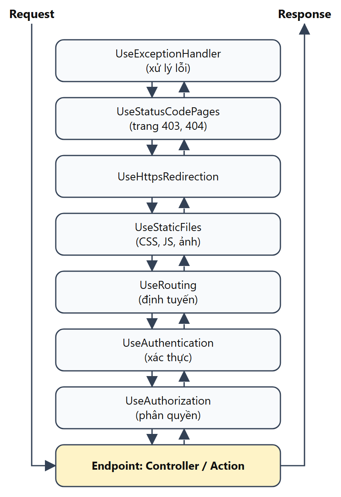
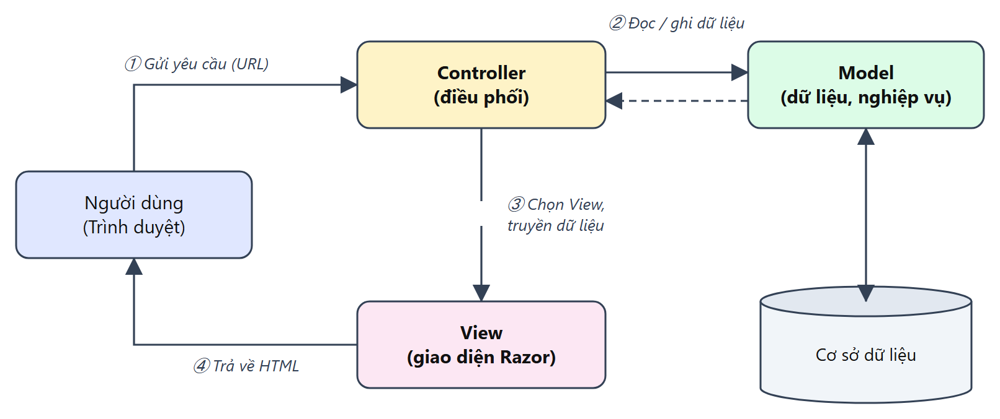
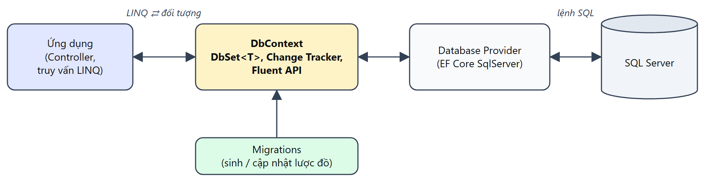

# CHƯƠNG 2. CƠ SỞ LÝ THUYẾT

Chương này trình bày cơ sở lý thuyết của các công nghệ được sử dụng trực tiếp trong đồ án: nền tảng ASP.NET Core, mô hình lập trình MVC, hệ quản trị cơ sở dữ liệu SQL Server, Entity Framework Core, LINQ, cơ chế Dependency Injection, xác thực – phân quyền và các kỹ thuật bảo mật ứng dụng web. Những công nghệ không sử dụng chỉ được nhắc tới ở mức so sánh để làm rõ lý do lựa chọn.

## 2.1. Khái quát về ASP.NET Core

### 2.1.1. Giới thiệu và các phiên bản

ASP.NET Core là framework mã nguồn mở, đa nền tảng do Microsoft phát triển để xây dựng các ứng dụng web, dịch vụ web (Web API) và ứng dụng thời gian thực [2]. Khác với ASP.NET truyền thống chỉ chạy trên Windows cùng .NET Framework, ASP.NET Core được thiết kế lại từ đầu, có thể chạy trên Windows, Linux và macOS, triển khai trên máy chủ riêng, trong container hoặc trên điện toán đám mây [3], [4].

Phiên bản ASP.NET Core 1.0 ra mắt năm 2016. Từ .NET 5 (năm 2020), Microsoft hợp nhất .NET Core và .NET Framework thành một nền tảng .NET duy nhất, phát hành định kỳ mỗi năm một phiên bản vào tháng 11. Các phiên bản số chẵn (.NET 6, .NET 8, .NET 10) là phiên bản hỗ trợ dài hạn (LTS – Long Term Support), các phiên bản số lẻ là phiên bản hỗ trợ ngắn hạn (STS – Standard Term Support).

Bảng 2.1. Một số phiên bản .NET gần đây

| Phiên bản | Năm phát hành | Loại hỗ trợ | Ghi chú |
|---|---|---|---|
| .NET 6 | 2021 | LTS | Giới thiệu mô hình cấu hình tối giản (minimal hosting) trong `Program.cs` |
| .NET 7 | 2022 | STS | Cải thiện hiệu năng, bổ sung tính năng cho Minimal API |
| .NET 8 | 2023 | LTS | Phiên bản sử dụng trong đồ án; đi kèm C# 12, EF Core 8 [5] |
| .NET 9 | 2024 | STS | |
| .NET 10 | 2025 | LTS | Phiên bản hỗ trợ dài hạn mới nhất |

Đồ án sử dụng .NET 8 vì đây là phiên bản LTS ổn định, tương thích tốt với Entity Framework Core 8 và có nhiều tài liệu, ví dụ tham khảo.

### 2.1.2. Ưu điểm của ASP.NET Core

- **Đa nền tảng và mã nguồn mở:** ứng dụng có thể phát triển trên Windows và triển khai trên Linux; mã nguồn công khai trên GitHub, được cộng đồng đóng góp.
- **Hiệu năng cao:** máy chủ web tích hợp Kestrel gọn nhẹ, xử lý bất đồng bộ (async/await) giúp phục vụ nhiều yêu cầu đồng thời với tài nguyên thấp.
- **Kiến trúc mô-đun:** ứng dụng chỉ nạp những thành phần cần thiết thông qua chuỗi middleware, dễ mở rộng hoặc thay thế.
- **Tích hợp sẵn Dependency Injection:** các dịch vụ được đăng ký và cấp phát tự động, giúp mã nguồn ít phụ thuộc lẫn nhau, dễ kiểm thử.
- **Hợp nhất nhiều mô hình lập trình:** MVC, Razor Pages, Blazor, Web API dùng chung một nền tảng, cùng cơ chế định tuyến, cấu hình, xác thực.
- **Bảo mật tích hợp:** hỗ trợ sẵn xác thực, phân quyền, chống giả mạo yêu cầu (CSRF), mã hóa dữ liệu đầu ra, bảo vệ dữ liệu nhạy cảm.

### 2.1.3. Kiến trúc và luồng xử lý yêu cầu

Một ứng dụng ASP.NET Core được khởi tạo trong tệp `Program.cs` theo hai giai đoạn. Giai đoạn thứ nhất dùng đối tượng `WebApplicationBuilder` để đọc cấu hình (tệp `appsettings.json`, biến môi trường) và đăng ký các dịch vụ vào bộ chứa Dependency Injection. Giai đoạn thứ hai tạo đối tượng `WebApplication`, khai báo chuỗi middleware xử lý yêu cầu và các điểm cuối (endpoint), sau đó khởi động máy chủ Kestrel.

**Middleware** là các thành phần được ghép nối thành một chuỗi (pipeline); mỗi middleware nhận yêu cầu HTTP, có thể xử lý, chuyển tiếp cho middleware kế tiếp, rồi tiếp tục xử lý phản hồi theo chiều ngược lại [6]. Thứ tự khai báo middleware quyết định thứ tự xử lý, ví dụ middleware xác thực phải đứng trước middleware phân quyền. Hình 2.1 minh họa chuỗi middleware được sử dụng trong đồ án.



Ý nghĩa các middleware chính:

- `UseExceptionHandler`, `UseStatusCodePages`: bắt lỗi phát sinh và hiển thị trang báo lỗi thân thiện (403, 404).
- `UseHttpsRedirection`: chuyển hướng yêu cầu HTTP sang HTTPS.
- `UseStaticFiles`: phục vụ trực tiếp các tệp tĩnh trong thư mục `wwwroot` (CSS, JavaScript, hình ảnh) mà không cần đi tiếp vào controller.
- `UseRouting`: xác định endpoint (controller, action) phù hợp với URL.
- `UseAuthentication`, `UseAuthorization`: xác định người dùng là ai từ cookie đăng nhập và kiểm tra người dùng có quyền truy cập endpoint hay không.

## 2.2. Các mô hình lập trình

### 2.2.1. Mô hình MVC

MVC (Model – View – Controller) là mẫu kiến trúc chia ứng dụng thành ba thành phần có trách nhiệm tách biệt [7]:

- **Model:** biểu diễn dữ liệu và quy tắc nghiệp vụ. Trong ASP.NET Core, Model gồm các lớp thực thể (entity) ánh xạ với bảng cơ sở dữ liệu và các lớp ViewModel chứa dữ liệu cần hiển thị hoặc dữ liệu người dùng nhập vào.
- **View:** phần giao diện, được viết bằng cú pháp Razor – kết hợp HTML với mã C# (bắt đầu bằng ký tự `@`) để sinh ra trang HTML động.
- **Controller:** tiếp nhận yêu cầu, gọi Model để đọc / ghi dữ liệu, sau đó chọn View phù hợp và truyền dữ liệu cho View hiển thị.



Việc tách biệt ba thành phần giúp mã nguồn rõ ràng, dễ bảo trì, nhiều người có thể làm việc song song trên giao diện và xử lý; logic nghiệp vụ không bị trộn lẫn vào mã HTML. Các thành phần quan trọng của ASP.NET Core MVC được sử dụng trong đồ án gồm:

**Định tuyến (Routing).** Định tuyến ánh xạ URL tới action của controller [8]. ASP.NET Core hỗ trợ hai cách: định tuyến theo quy ước (conventional routing) với mẫu chung như `{controller}/{action}/{id?}`, và định tuyến bằng thuộc tính (attribute routing) gắn trực tiếp lên action, cho phép tạo URL thân thiện, ví dụ:

```
[HttpGet("du-an/{slug}")]
public async Task<IActionResult> Detail(string slug) { ... }
```

**Model binding và kiểm tra dữ liệu (Validation).** Khi người dùng gửi form, ASP.NET Core tự động gán giá trị các trường vào tham số hoặc đối tượng ViewModel của action (model binding). Các quy tắc kiểm tra được khai báo bằng thuộc tính chú thích dữ liệu (DataAnnotations) như `[Required]`, `[StringLength]`, `[EmailAddress]`, `[Compare]`; kết quả kiểm tra nằm trong `ModelState` [9]. Cùng một khai báo được dùng để kiểm tra ở cả phía máy chủ và phía trình duyệt (kết hợp thư viện jQuery Validation):

```
[Required(ErrorMessage = "Vui lòng nhập email")]
[EmailAddress(ErrorMessage = "Email không hợp lệ")]
public string Email { get; set; }
```

**Razor, Layout, Partial View và Tag Helper.** Layout định nghĩa khung chung của trang (đầu trang, menu, chân trang); Partial View là đoạn giao diện dùng lại ở nhiều nơi (ví dụ thẻ hiển thị một dự án). Tag Helper cho phép viết thuộc tính phía máy chủ ngay trên thẻ HTML [10]; ví dụ thẻ `<a asp-controller="Projects" asp-action="Detail" asp-route-slug="zalord">` được sinh thành `<a href="/du-an/zalord">`, còn thẻ `<form>` tự động chèn token chống giả mạo yêu cầu.

**Area.** Area chia ứng dụng lớn thành các khu vực chức năng độc lập, mỗi khu vực có controller, view và layout riêng [11]. Đồ án dùng Area `Admin` cho toàn bộ khu vực quản trị.

**Filter.** Filter là các thuộc tính gắn lên controller hoặc action để chạy mã trước hoặc sau action, ví dụ `[Authorize]` kiểm tra quyền truy cập, `[ValidateAntiForgeryToken]` kiểm tra token chống giả mạo.

### 2.2.2. Các mô hình lập trình khác và lý do lựa chọn MVC

Ngoài MVC, ASP.NET Core còn cung cấp một số mô hình xây dựng giao diện và dịch vụ khác [12]. Bảng 2.2 so sánh ngắn gọn các mô hình này.

Bảng 2.2. So sánh các mô hình lập trình trên nền tảng ASP.NET

| Mô hình | Đặc điểm | Phù hợp với |
|---|---|---|
| MVC | Tách Model – View – Controller; một controller xử lý nhiều action; render HTML phía máy chủ | Website nhiều chức năng, nhiều vai trò người dùng |
| Razor Pages | Mỗi trang gồm tệp giao diện và lớp xử lý đi kèm (PageModel) | Ứng dụng hướng trang, ít logic dùng chung |
| Blazor | Viết giao diện tương tác bằng C# thay cho JavaScript, theo mô hình component | Ứng dụng web tương tác cao dạng SPA |
| Web API / Minimal API | Trả về dữ liệu JSON thay vì HTML | Dịch vụ cho ứng dụng di động, SPA, tích hợp hệ thống |
| Web Forms | Mô hình hướng sự kiện, điều khiển máy chủ (server control), ViewState | Ứng dụng cũ trên .NET Framework; không có trên ASP.NET Core |

Đồ án lựa chọn mô hình MVC vì: (1) hệ thống có nhiều nhóm chức năng và ba vai trò người dùng, cách tổ chức theo controller giúp gom các chức năng liên quan (dự án, tài khoản, quản trị) vào một nơi; (2) website cần hiển thị tốt với công cụ tìm kiếm và chia sẻ liên kết, nên việc render HTML phía máy chủ phù hợp hơn SPA; (3) MVC là mô hình phổ biến, có nhiều tài liệu và phù hợp nội dung học phần. Các tương tác cần phản hồi nhanh như bình chọn được bổ sung bằng AJAX (jQuery) mà không cần chuyển sang Blazor.

## 2.3. Công nghệ liên quan

### 2.3.1. Hệ quản trị cơ sở dữ liệu SQL Server

Microsoft SQL Server là hệ quản trị cơ sở dữ liệu quan hệ, sử dụng ngôn ngữ truy vấn T-SQL [13]. SQL Server hỗ trợ đầy đủ các ràng buộc toàn vẹn (khóa chính, khóa ngoại, duy nhất, kiểm tra CHECK, giá trị mặc định), giao dịch (transaction), chỉ mục và phân quyền truy cập. Phiên bản Express miễn phí, giới hạn dung lượng mỗi cơ sở dữ liệu ở mức 10 GB, phù hợp cho học tập và các hệ thống quy mô nhỏ.

Một tính năng được đồ án tận dụng là **collation** (quy tắc so sánh và sắp xếp chuỗi). Collation `Vietnamese_CI_AI` so sánh không phân biệt hoa thường (CI – Case Insensitive) và không phân biệt dấu (AI – Accent Insensitive), nhờ đó từ khóa “khoi nghiep” vẫn khớp với chuỗi “Khởi nghiệp”, phù hợp với thói quen gõ không dấu của người dùng Việt Nam.

### 2.3.2. Entity Framework Core

Entity Framework Core (EF Core) là ORM (Object – Relational Mapping) của .NET, cho phép lập trình viên làm việc với cơ sở dữ liệu thông qua các đối tượng C# thay vì viết câu lệnh SQL thủ công [14]. EF Core đóng vai trò trung gian giữa ứng dụng và cơ sở dữ liệu như Hình 2.3.



Các khái niệm chính:

- **DbContext:** lớp đại diện cho một phiên làm việc với cơ sở dữ liệu, chứa các tập `DbSet<T>` tương ứng với các bảng; theo dõi thay đổi của đối tượng (change tracking) và lưu xuống cơ sở dữ liệu khi gọi `SaveChanges()`.
- **Code First:** khai báo lớp thực thể trước, EF Core sinh lược đồ cơ sở dữ liệu tương ứng. Cấu hình chi tiết (độ dài cột, khóa, chỉ mục, quan hệ, hành vi khi xóa) được khai báo bằng Fluent API trong phương thức `OnModelCreating`.
- **Migration:** cơ chế ghi lại các thay đổi của mô hình dữ liệu thành các tệp mã nguồn, từ đó cập nhật lược đồ cơ sở dữ liệu tương ứng mà không mất dữ liệu [15]. Lịch sử migration đã áp dụng được lưu trong bảng `__EFMigrationsHistory`. Các lệnh thường dùng: `dotnet ef migrations add <Tên>` để tạo migration, `dotnet ef database update` để áp dụng vào cơ sở dữ liệu.
- **Quan hệ và hành vi khi xóa:** EF Core hỗ trợ quan hệ một – nhiều, nhiều – nhiều, tự tham chiếu; hành vi khi xóa bản ghi cha có thể là xóa theo (Cascade), đặt giá trị rỗng (SetNull) hoặc không cho phép (Restrict).

### 2.3.3. LINQ

LINQ (Language Integrated Query) là tập tính năng của C# cho phép viết truy vấn dữ liệu ngay trong ngôn ngữ lập trình, với cú pháp thống nhất cho nhiều nguồn dữ liệu: danh sách trong bộ nhớ, XML, cơ sở dữ liệu [16]. Khi dùng với EF Core, truy vấn LINQ trên `DbSet<T>` được dịch thành câu lệnh SQL tương ứng và chỉ được thực thi khi kết quả thật sự được lấy ra (thực thi trì hoãn – deferred execution), ví dụ khi gọi `ToListAsync()`.

Ví dụ truy vấn ba dự án đã duyệt có lượt xem cao nhất:

```
var top = await _db.Projects
    .Where(p => p.Status == ProjectStatus.DaDuyet)
    .OrderByDescending(p => p.ViewCount)
    .Take(3)
    .ToListAsync();
```

EF Core dịch truy vấn trên thành câu lệnh SQL (rút gọn):

```
SELECT TOP(@__p_0) [p].[ProjectId], [p].[ProjectName], ...
FROM [Project] AS [p]
WHERE [p].[Status] = CAST(2 AS tinyint)
ORDER BY [p].[ViewCount] DESC
```

Ưu điểm của LINQ là được trình biên dịch kiểm tra kiểu dữ liệu, hạn chế lỗi chính tả trong câu lệnh; đồng thời các giá trị đầu vào luôn được truyền dưới dạng tham số (như `@__p_0`), giúp ngăn chặn tấn công SQL Injection.

### 2.3.4. Dependency Injection

Dependency Injection (DI – tiêm phụ thuộc) là kỹ thuật trong đó một lớp không tự khởi tạo các đối tượng mà nó phụ thuộc, mà nhận chúng từ bên ngoài, thường qua tham số của hàm khởi tạo (constructor). ASP.NET Core tích hợp sẵn bộ chứa DI [17]: các dịch vụ được đăng ký trong `Program.cs`, sau đó framework tự động tạo và truyền vào controller khi cần.

```
builder.Services.AddDbContext<AppDbContext>(options =>
    options.UseSqlServer(builder.Configuration.GetConnectionString("DefaultConnection")));
builder.Services.AddScoped<IFileStorageService, FileStorageService>();
```

Mỗi dịch vụ được đăng ký với một vòng đời (lifetime) như Bảng 2.3.

Bảng 2.3. Các vòng đời dịch vụ trong Dependency Injection

| Vòng đời | Cách đăng ký | Ý nghĩa | Ví dụ trong đồ án |
|---|---|---|---|
| Transient | `AddTransient` | Tạo đối tượng mới mỗi lần được yêu cầu | – |
| Scoped | `AddScoped` | Một đối tượng dùng chung trong phạm vi một yêu cầu HTTP | `AppDbContext`, `IFileStorageService`, `IPasswordHasher` |
| Singleton | `AddSingleton` | Một đối tượng duy nhất cho toàn bộ ứng dụng | `IHtmlSanitizer` (bộ lọc HTML) |

Lợi ích của DI: các lớp phụ thuộc vào giao diện (interface) thay vì lớp cụ thể nên dễ thay thế, dễ kiểm thử; vòng đời đối tượng được quản lý tập trung, tránh rò rỉ tài nguyên như kết nối cơ sở dữ liệu.

### 2.3.5. Xác thực và phân quyền

**Xác thực (Authentication)** là quá trình xác định người dùng là ai; **phân quyền (Authorization)** là quá trình xác định người dùng đã xác thực được phép làm gì. ASP.NET Core cung cấp một số cơ chế xác thực:

- **ASP.NET Core Identity:** hệ thống quản lý thành viên đầy đủ (đăng ký, xác nhận email, khôi phục mật khẩu, xác thực hai lớp, đăng nhập ngoài), kèm sẵn bộ bảng dữ liệu riêng.
- **JWT (JSON Web Token):** chuỗi mã thông báo có chữ ký số, gửi kèm mỗi yêu cầu; thường dùng cho Web API, ứng dụng di động.
- **Cookie Authentication:** sau khi đăng nhập thành công, máy chủ ghi một cookie đã được mã hóa chứa thông tin người dùng; trình duyệt tự gửi cookie này trong các yêu cầu sau [18].

Đồ án sử dụng **Cookie Authentication** kết hợp với bảng `Account` tự thiết kế, vì website render HTML phía máy chủ (không phải Web API nên không cần JWT) và chỉ cần các chức năng cơ bản; cách làm này giữ cơ sở dữ liệu gọn và mã nguồn dễ kiểm soát hơn so với dùng toàn bộ ASP.NET Core Identity. Thông tin người dùng được lưu trong cookie dưới dạng tập **claim** (mã tài khoản, họ tên, email, vai trò); cookie được bảo vệ bởi cơ chế Data Protection của ASP.NET Core nên người dùng không thể tự sửa nội dung.

Phân quyền được thực hiện theo **vai trò (role-based authorization)** [19]: thuộc tính `[Authorize(Roles = "Admin")]` gắn trên controller hoặc action chỉ cho phép người dùng có claim vai trò tương ứng truy cập; người chưa đăng nhập được chuyển tới trang đăng nhập, người không đủ quyền nhận trang báo lỗi 403.

**Lưu trữ mật khẩu an toàn.** Mật khẩu không bao giờ được lưu ở dạng rõ mà phải được băm (hash) bằng thuật toán một chiều. Đồ án dùng lớp `PasswordHasher` của ASP.NET Core [20], cài đặt thuật toán PBKDF2 với HMAC-SHA512, 100.000 vòng lặp và giá trị salt ngẫu nhiên 128 bit cho mỗi mật khẩu. Salt ngẫu nhiên khiến hai người dùng có cùng mật khẩu vẫn cho ra hai chuỗi băm khác nhau; số vòng lặp lớn làm chậm đáng kể các cuộc tấn công dò mật khẩu.

### 2.3.6. Bảo mật ứng dụng web

Danh sách OWASP Top 10 [21] tổng hợp các rủi ro bảo mật phổ biến nhất của ứng dụng web. Đồ án tập trung phòng chống ba dạng tấn công thường gặp:

- **SQL Injection:** kẻ tấn công chèn câu lệnh SQL vào dữ liệu nhập (ví dụ ô tìm kiếm) để đọc trộm hoặc phá hủy dữ liệu. Biện pháp: không ghép chuỗi khi tạo câu lệnh SQL; mọi truy vấn trong đồ án thực hiện qua EF Core / LINQ nên giá trị đầu vào luôn được truyền dưới dạng tham số.
- **XSS (Cross-Site Scripting):** kẻ tấn công chèn mã JavaScript vào nội dung (bình luận, phần giới thiệu dự án) để mã này chạy trên trình duyệt của người khác, đánh cắp phiên đăng nhập [22]. Biện pháp: Razor tự động mã hóa (encode) mọi dữ liệu khi hiển thị; riêng nội dung cho phép định dạng HTML được lọc bằng thư viện HtmlSanitizer [23] trước khi lưu, chỉ giữ lại các thẻ định dạng an toàn.
- **CSRF (Cross-Site Request Forgery):** trang web độc hại lợi dụng cookie đăng nhập của nạn nhân để gửi yêu cầu giả mạo (ví dụ xóa dự án). Biện pháp: ASP.NET Core sinh một token chống giả mạo (anti-forgery token) ẩn trong mỗi form; máy chủ chỉ chấp nhận yêu cầu POST có token hợp lệ, được kiểm tra bằng thuộc tính `[ValidateAntiForgeryToken]` hoặc `[AutoValidateAntiforgeryToken]` [24].

Ngoài ra, chức năng tải tệp lên là điểm dễ bị khai thác nếu cho phép tải tệp tùy ý. Đồ án chỉ chấp nhận định dạng ảnh .jpg, .png, .webp, giới hạn dung lượng, kiểm tra chữ ký nhận dạng ở các byte đầu tệp (magic number) để phát hiện tệp giả mạo phần mở rộng, đồng thời đổi tên tệp ngẫu nhiên khi lưu.

### 2.3.7. Các thư viện giao diện

- **Bootstrap 5** [25]: framework CSS cung cấp hệ thống lưới (grid) 12 cột và các thành phần giao diện (thanh menu, thẻ, form, hộp thoại, carousel); giao diện tự co giãn theo kích thước màn hình (responsive).
- **jQuery và AJAX:** jQuery giúp thao tác với các phần tử trang và gửi yêu cầu AJAX – gửi dữ liệu lên máy chủ và cập nhật một phần trang mà không tải lại toàn bộ; đồ án dùng cho chức năng bình chọn. Thư viện jQuery Validation kết hợp với DataAnnotations để kiểm tra dữ liệu nhập ngay trên trình duyệt.
- **Chart.js** [26]: thư viện vẽ biểu đồ bằng JavaScript (đường, cột, tròn), dùng cho trang thống kê quản trị.
- **Quill:** trình soạn thảo văn bản trên trình duyệt, cho phép sinh viên định dạng phần giới thiệu dự án (đậm, nghiêng, danh sách, liên kết).

## Tiểu kết chương 2

Chương 2 đã trình bày nền tảng ASP.NET Core và luồng xử lý yêu cầu qua chuỗi middleware; mô hình MVC cùng các thành phần định tuyến, kiểm tra dữ liệu, Razor, Area, Filter; lý do lựa chọn MVC so với các mô hình khác; các công nghệ liên quan gồm SQL Server, Entity Framework Core, LINQ, Dependency Injection, xác thực bằng cookie và phân quyền theo vai trò; các kỹ thuật bảo mật ứng dụng web và thư viện giao diện. Đây là cơ sở để phân tích, thiết kế hệ thống ở Chương 3 và cài đặt ở Chương 4.
