# CHƯƠNG 3. PHÂN TÍCH VÀ THIẾT KẾ HỆ THỐNG

Chương này trình bày quá trình phân tích yêu cầu và thiết kế hệ thống website giới thiệu sản phẩm khởi nghiệp của sinh viên Trường Đại học Trà Vinh (tên gọi trong đồ án: TVU Startup). Nội dung gồm bốn phần: phân tích yêu cầu (tác nhân, yêu cầu chức năng và phi chức năng, use case), thiết kế cơ sở dữ liệu, thiết kế chức năng thông qua các sơ đồ tuần tự, trạng thái, hoạt động, và cuối cùng là thiết kế kiến trúc cùng giao diện các màn hình chính.

## 3.1. Phân tích yêu cầu

### 3.1.1. Mô tả bài toán

Trường Đại học Trà Vinh có nhiều sinh viên tham gia các cuộc thi ý tưởng và tự phát triển sản phẩm khởi nghiệp, tuy nhiên các sản phẩm này thường chỉ được giới thiệu rời rạc qua mạng xã hội hoặc trong các ngày hội, chưa có một nơi tập trung để cộng đồng, doanh nghiệp và nhà đầu tư tìm hiểu và kết nối. Hệ thống cần giải quyết các vấn đề sau:

- Sinh viên có nơi đăng và cập nhật thông tin dự án khởi nghiệp của mình: giới thiệu, tính năng, hình ảnh, các phiên bản phát hành, thành viên nhóm.
- Ban quản trị (cán bộ phụ trách hoạt động khởi nghiệp) kiểm duyệt nội dung trước khi công khai để bảo đảm tính chính xác và phù hợp.
- Người truy cập tìm kiếm, lọc dự án theo lĩnh vực, khoa, giai đoạn phát triển; bình luận, đánh giá, bình chọn và gửi yêu cầu hợp tác trực tiếp tới nhóm dự án.
- Ban quản trị theo dõi tổng quan số liệu (số dự án, lượt xem, liên hệ mới…) và quản lý các danh mục, tin tức, sự kiện.

### 3.1.2. Danh sách tác nhân

Bảng 3.1. Danh sách tác nhân của hệ thống

| STT | Tác nhân | Mô tả |
|---|---|---|
| 1 | Khách | Người truy cập chưa đăng nhập: doanh nghiệp, nhà đầu tư, giảng viên, sinh viên, cộng đồng. Được xem, tìm kiếm dự án, xem tin tức, gửi liên hệ hợp tác và đăng ký tài khoản. |
| 2 | Sinh viên | Sinh viên Trường Đại học Trà Vinh đã có tài khoản. Kế thừa toàn bộ chức năng của Khách; được đăng và quản lý dự án của mình, bình luận, đánh giá, bình chọn. |
| 3 | Quản trị viên | Cán bộ quản lý hệ thống. Duyệt dự án, quản lý danh mục, tài khoản, tin tức, banner, kiểm duyệt bình luận, xử lý liên hệ và xem thống kê. |

### 3.1.3. Yêu cầu chức năng

Các yêu cầu chức năng được đánh mã từ UC01 đến UC24 và phân theo tác nhân như các bảng sau.

Bảng 3.2. Yêu cầu chức năng của tác nhân Khách

| Mã | Chức năng | Mô tả |
|---|---|---|
| UC01 | Xem trang chủ | Xem số liệu tổng quan, dự án nổi bật, các lĩnh vực, dự án mới nhất, banner sự kiện và tin tức mới |
| UC02 | Tìm kiếm, lọc dự án | Tìm theo từ khóa (không phân biệt dấu tiếng Việt), lọc theo lĩnh vực, khoa, giai đoạn; sắp xếp và phân trang |
| UC03 | Xem chi tiết dự án | Xem giới thiệu, tính năng, hình ảnh, phiên bản công khai, đội ngũ, bình luận và dự án cùng lĩnh vực |
| UC04 | Xem tin tức, sự kiện | Xem danh sách và chi tiết tin tức, sự kiện, cuộc thi khởi nghiệp |
| UC05 | Gửi liên hệ hợp tác | Gửi yêu cầu hợp tác, đầu tư, sử dụng sản phẩm tới nhóm dự án hoặc Ban quản trị, không cần đăng nhập |
| UC06 | Đăng ký tài khoản | Tạo tài khoản sinh viên với email, mã số sinh viên, lớp, khoa |

Bảng 3.3. Yêu cầu chức năng của tác nhân Sinh viên

| Mã | Chức năng | Mô tả |
|---|---|---|
| UC07 | Đăng nhập / đăng xuất | Đăng nhập bằng email và mật khẩu (dùng chung với Quản trị viên) |
| UC08 | Cập nhật hồ sơ, đổi mật khẩu | Sửa họ tên, số điện thoại, lớp, khoa, ảnh đại diện; đổi mật khẩu |
| UC09 | Quản lý dự án của tôi | Thêm, sửa thông tin chung, xóa dự án (khi đang Nháp hoặc Bị từ chối), xem trước dự án |
| UC10 | Quản lý nội dung dự án | Thêm, xóa hình ảnh, tính năng nổi bật, phiên bản (công khai hoặc nội bộ), thành viên nhóm |
| UC11 | Gửi duyệt / rút lại | Gửi dự án cho Ban quản trị duyệt; rút lại khi đang chờ duyệt để chỉnh sửa tiếp |
| UC12 | Bình luận, đánh giá | Viết bình luận, chấm 1–5 sao cho dự án; chủ dự án trả lời bình luận |
| UC13 | Bình chọn dự án | Bật / tắt lượt yêu thích cho dự án của sinh viên khác |
| UC14 | Xem liên hệ hợp tác | Xem các yêu cầu liên hệ gửi tới dự án của mình và cập nhật trạng thái xử lý |

Bảng 3.4. Yêu cầu chức năng của tác nhân Quản trị viên

| Mã | Chức năng | Mô tả |
|---|---|---|
| UC15 | Xem thống kê | Dashboard: số dự án theo trạng thái, lĩnh vực, khoa, theo tháng; lượt xem, bình chọn, bình luận; việc cần xử lý |
| UC16 | Duyệt dự án | Duyệt, từ chối (bắt buộc nêu lý do), ẩn / hiện lại, xóa dự án |
| UC17 | Đánh dấu nổi bật | Chọn dự án đã duyệt để hiển thị ở mục nổi bật trên trang chủ |
| UC18 | Quản lý lĩnh vực | Thêm, sửa, xóa, tạm ngừng sử dụng lĩnh vực |
| UC19 | Quản lý khoa | Thêm, sửa, xóa khoa |
| UC20 | Quản lý tài khoản | Tìm kiếm, khóa / mở khóa tài khoản, đặt lại mật khẩu |
| UC21 | Quản lý tin tức, sự kiện | Thêm, sửa, xóa, xuất bản bài viết |
| UC22 | Quản lý banner | Thêm, sửa, xóa, bật / tắt banner trang chủ |
| UC23 | Kiểm duyệt bình luận | Ẩn, hiện lại, xóa bình luận vi phạm |
| UC24 | Xử lý liên hệ hợp tác | Theo dõi và cập nhật trạng thái liên hệ: Mới, Đã liên hệ, Đã đóng |

### 3.1.4. Yêu cầu phi chức năng

Bảng 3.5. Yêu cầu phi chức năng

| Nhóm | Yêu cầu | Giải pháp đáp ứng |
|---|---|---|
| Bảo mật | Không lưu mật khẩu dạng rõ | Băm mật khẩu bằng `PasswordHasher` của ASP.NET Core (PBKDF2, có salt ngẫu nhiên) |
| | Phân quyền theo vai trò | Xác thực bằng Cookie Authentication, phân quyền bằng thuộc tính `[Authorize(Roles = ...)]` |
| | Chống SQL Injection | Mọi truy vấn thực hiện qua Entity Framework Core / LINQ, tham số được truyền tách biệt |
| | Chống XSS | Razor tự mã hóa dữ liệu khi hiển thị; nội dung HTML do người dùng nhập được lọc bằng thư viện HtmlSanitizer trước khi lưu |
| | Chống CSRF | Mọi form gửi bằng phương thức POST đều kèm token chống giả mạo (Anti-forgery token) |
| | Tải tệp an toàn | Chỉ nhận ảnh .jpg, .png, .webp tối đa 2 MB, kiểm tra chữ ký tệp, đổi tên ngẫu nhiên khi lưu |
| Hiệu năng | Trang danh sách phản hồi nhanh | Phân trang 9 dự án / trang, chỉ truy vấn các cột cần hiển thị, dùng `AsNoTracking` cho truy vấn chỉ đọc |
| Khả dụng | Dùng tốt trên điện thoại | Giao diện responsive bằng Bootstrap 5 |
| | Phù hợp người dùng Việt Nam | Giao diện tiếng Việt, đường dẫn thân thiện không dấu, tìm kiếm không phân biệt dấu |
| Bảo trì | Dễ cài đặt, triển khai lại | Tạo cơ sở dữ liệu bằng EF Core Migration, dữ liệu mẫu nạp tự động khi chạy lần đầu |

### 3.1.5. Sơ đồ use case tổng quát

Sơ đồ use case tổng quát (Hình 3.1) thể hiện ba tác nhân và 24 use case của hệ thống. Tác nhân Sinh viên kế thừa tác nhân Khách, nghĩa là sinh viên sau khi đăng nhập vẫn sử dụng được mọi chức năng dành cho khách. Chức năng Đăng nhập / đăng xuất (UC07) được dùng chung bởi Sinh viên và Quản trị viên. Toàn bộ use case được đặt trong ranh giới hệ thống TVU Startup.

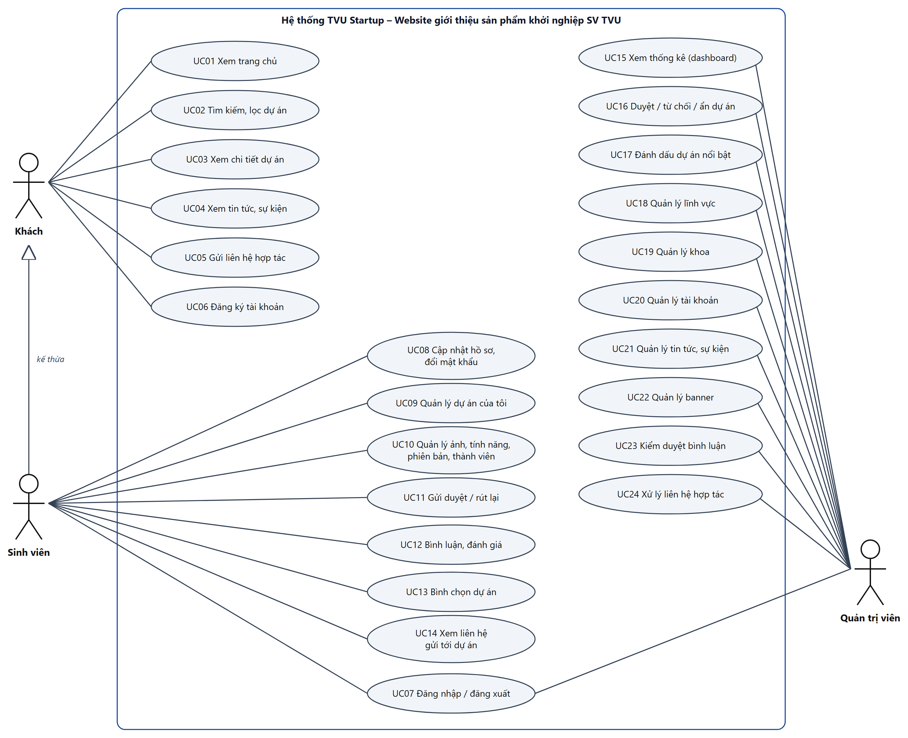

### 3.1.6. Đặc tả các use case chính

Phần này đặc tả sáu use case quan trọng nhất, gắn với luồng nghiệp vụ chính của hệ thống: đăng nhập, đăng dự án và gửi duyệt, duyệt dự án, tìm kiếm, bình luận đánh giá và gửi liên hệ hợp tác.

Bảng 3.6. Đặc tả use case Đăng nhập (UC07)

| Mục | Nội dung |
|---|---|
| Tên use case | Đăng nhập |
| Tác nhân | Sinh viên, Quản trị viên |
| Mô tả | Người dùng đăng nhập bằng email và mật khẩu để sử dụng các chức năng theo vai trò |
| Tiền điều kiện | Người dùng đã có tài khoản và chưa đăng nhập |
| Luồng chính | 1. Người dùng mở trang Đăng nhập. 2. Người dùng nhập email, mật khẩu, có thể chọn “Ghi nhớ đăng nhập”, rồi bấm Đăng nhập. 3. Hệ thống kiểm tra token chống giả mạo và tính hợp lệ của dữ liệu nhập. 4. Hệ thống tìm tài khoản theo email và so khớp mật khẩu với chuỗi băm đã lưu. 5. Hệ thống tạo cookie đăng nhập chứa mã tài khoản, họ tên, email, vai trò. 6. Quản trị viên được chuyển tới trang quản trị; sinh viên được chuyển về trang trước đó hoặc trang chủ. |
| Luồng thay thế | 3a. Email để trống hoặc sai định dạng: hệ thống báo lỗi ngay tại ô nhập. 4a. Email không tồn tại hoặc sai mật khẩu: hệ thống báo “Email hoặc mật khẩu không đúng”, quay lại bước 2. 4b. Tài khoản đang bị khóa: hệ thống báo “Tài khoản của bạn đã bị khóa”. |
| Hậu điều kiện | Người dùng ở trạng thái đã đăng nhập; menu hiển thị các chức năng theo vai trò |

Bảng 3.7. Đặc tả use case Đăng dự án và gửi duyệt (UC09, UC11)

| Mục | Nội dung |
|---|---|
| Tên use case | Đăng dự án và gửi duyệt |
| Tác nhân | Sinh viên |
| Mô tả | Sinh viên tạo dự án khởi nghiệp, bổ sung nội dung và gửi cho Ban quản trị duyệt |
| Tiền điều kiện | Sinh viên đã đăng nhập |
| Luồng chính | 1. Sinh viên chọn “Đăng dự án mới”. 2. Sinh viên nhập tên dự án, slogan, mô tả ngắn, lĩnh vực, khoa, giai đoạn, giới thiệu chi tiết; chọn logo và ảnh bìa. 3. Hệ thống kiểm tra dữ liệu, lọc mã HTML không an toàn, lưu ảnh, tạo đường dẫn không trùng và lưu dự án ở trạng thái Nháp; người tạo được thêm làm thành viên đầu tiên. 4. Sinh viên bổ sung tính năng nổi bật, hình ảnh, phiên bản, thành viên nhóm. 5. Sinh viên bấm “Gửi duyệt”. 6. Hệ thống kiểm tra dự án đã có ảnh bìa và ít nhất một tính năng, sau đó chuyển dự án sang trạng thái Chờ duyệt. |
| Luồng thay thế | 3a. Thiếu trường bắt buộc, hoặc ảnh không đúng định dạng / quá 2 MB: hệ thống báo lỗi và giữ nguyên dữ liệu đã nhập. 6a. Dự án chưa có ảnh bìa hoặc tính năng: hệ thống báo “Chưa thể gửi duyệt, dự án còn thiếu …”. 6b. Khi dự án đang Chờ duyệt, sinh viên có thể bấm “Rút lại” để đưa dự án về trạng thái Nháp. |
| Hậu điều kiện | Dự án ở trạng thái Chờ duyệt và xuất hiện trong danh sách duyệt của Quản trị viên |

Bảng 3.8. Đặc tả use case Duyệt dự án (UC16)

| Mục | Nội dung |
|---|---|
| Tên use case | Duyệt dự án |
| Tác nhân | Quản trị viên |
| Mô tả | Quản trị viên kiểm tra nội dung dự án sinh viên gửi lên và quyết định công khai hoặc từ chối |
| Tiền điều kiện | Quản trị viên đã đăng nhập; có dự án ở trạng thái Chờ duyệt |
| Luồng chính | 1. Quản trị viên mở trang “Duyệt dự án” và lọc các dự án Chờ duyệt. 2. Quản trị viên bấm xem trước để kiểm tra trang dự án. 3. Quản trị viên bấm “Duyệt”. 4. Hệ thống chuyển dự án sang trạng thái Đã duyệt, ghi nhận thời điểm và người duyệt. 5. Dự án hiển thị trên trang chủ, trang danh sách và kết quả tìm kiếm. |
| Luồng thay thế | 3a. Quản trị viên bấm “Từ chối” và nhập lý do: hệ thống chuyển dự án sang trạng thái Bị từ chối, sinh viên xem được lý do tại trang “Dự án của tôi”. 3b. Quản trị viên để trống lý do từ chối: hệ thống báo lỗi, trạng thái không thay đổi. 3c. Với dự án đã duyệt, quản trị viên có thể ẩn / hiện lại hoặc đánh dấu nổi bật. |
| Hậu điều kiện | Trạng thái dự án được cập nhật |

Bảng 3.9. Đặc tả use case Tìm kiếm, lọc dự án (UC02)

| Mục | Nội dung |
|---|---|
| Tên use case | Tìm kiếm, lọc dự án |
| Tác nhân | Khách (và mọi người dùng) |
| Mô tả | Tìm dự án theo từ khóa, lọc theo lĩnh vực, khoa, giai đoạn; sắp xếp và phân trang kết quả |
| Tiền điều kiện | Không |
| Luồng chính | 1. Người dùng nhập từ khóa ở thanh tìm kiếm hoặc mở trang “Dự án khởi nghiệp”. 2. Người dùng chọn lĩnh vực, khoa, giai đoạn và cách sắp xếp (mới nhất, xem nhiều, yêu thích nhiều, tên A–Z). 3. Hệ thống chỉ lấy các dự án Đã duyệt, so khớp từ khóa trên tên, slogan và mô tả ngắn mà không phân biệt chữ hoa thường và dấu tiếng Việt. 4. Hệ thống hiển thị số kết quả và danh sách dự án, mỗi trang 9 dự án. |
| Luồng thay thế | 3a. Không có kết quả phù hợp: hệ thống hiển thị thông báo và nút xóa bộ lọc. |
| Hậu điều kiện | Không thay đổi dữ liệu |

Bảng 3.10. Đặc tả use case Bình luận, đánh giá (UC12)

| Mục | Nội dung |
|---|---|
| Tên use case | Bình luận, đánh giá |
| Tác nhân | Sinh viên |
| Mô tả | Người dùng viết bình luận và chấm từ 1 đến 5 sao cho dự án đã công khai |
| Tiền điều kiện | Người dùng đã đăng nhập; dự án ở trạng thái Đã duyệt |
| Luồng chính | 1. Tại trang chi tiết dự án, người dùng chọn số sao và nhập nội dung bình luận (tối đa 1000 ký tự). 2. Người dùng bấm “Gửi bình luận”. 3. Hệ thống lưu bình luận; điểm đánh giá trung bình được tính lại khi hiển thị trang. |
| Luồng thay thế | 1a. Chủ dự án không được tự chấm sao cho dự án của mình; mỗi tài khoản chỉ chấm sao một lần cho mỗi dự án. 2a. Chủ dự án hoặc Quản trị viên bấm “Trả lời” dưới một bình luận để phản hồi. 2b. Người viết bình luận hoặc Quản trị viên có thể xóa bình luận (các câu trả lời bị xóa theo). |
| Hậu điều kiện | Bình luận hiển thị dưới trang dự án; nội dung được mã hóa khi hiển thị để chống chèn mã độc |

Bảng 3.11. Đặc tả use case Gửi liên hệ hợp tác (UC05)

| Mục | Nội dung |
|---|---|
| Tên use case | Gửi liên hệ hợp tác |
| Tác nhân | Khách (doanh nghiệp, nhà đầu tư, người dùng sản phẩm) |
| Mô tả | Gửi đề nghị hợp tác, đầu tư hoặc sử dụng sản phẩm tới nhóm dự án |
| Tiền điều kiện | Dự án ở trạng thái Đã duyệt |
| Luồng chính | 1. Người dùng bấm “Liên hệ hợp tác” trên trang dự án. 2. Người dùng nhập họ tên, email, số điện thoại, đơn vị, nhu cầu và nội dung. 3. Hệ thống kiểm tra token chống giả mạo và dữ liệu nhập, lưu yêu cầu ở trạng thái Mới và thông báo gửi thành công. 4. Sinh viên chủ dự án và Quản trị viên xem yêu cầu, liên hệ lại với người gửi và cập nhật trạng thái Đã liên hệ hoặc Đã đóng. |
| Luồng thay thế | 3a. Dữ liệu không hợp lệ: hệ thống báo lỗi. 1a. Người dùng gửi liên hệ chung tới Ban quản trị qua trang “Liên hệ” (không gắn với dự án cụ thể). |
| Hậu điều kiện | Yêu cầu liên hệ được lưu; khi dự án bị xóa, yêu cầu liên hệ vẫn được giữ lại |

## 3.2. Thiết kế cơ sở dữ liệu

### 3.2.1. Sơ đồ thực thể – liên kết

Cơ sở dữ liệu `TVUStartupDB` được xây dựng theo hướng Code First của Entity Framework Core: các lớp thực thể C# được khai báo trước, sau đó EF Core sinh migration để tạo bảng trên SQL Server. Hệ thống gồm 14 bảng nghiệp vụ và bảng `__EFMigrationsHistory` do EF Core tự tạo để lưu lịch sử migration.

Bảng `Project` là trung tâm của mô hình: mỗi dự án thuộc một lĩnh vực (`Category`), một khoa (`Faculty`), do một tài khoản sinh viên sở hữu (`Account`), có nhiều hình ảnh, tính năng, phiên bản, thành viên, bình luận, lượt bình chọn và yêu cầu liên hệ. Bảng `Vote` dùng khóa chính ghép (ProjectId, AccountId) để mỗi tài khoản chỉ bình chọn một dự án một lần. Bảng `Comment` có quan hệ tự tham chiếu qua cột `ParentId` để biểu diễn câu trả lời của chủ dự án.

Hình 3.2 trình bày sơ đồ thực thể – liên kết ở dạng rút gọn: mỗi thực thể chỉ thể hiện khóa chính (PK), khóa ngoại (FK) và các thuộc tính chính; ký hiệu “1” và “n” ở hai đầu đường nối thể hiện bản số của quan hệ. Sơ đồ đầy đủ toàn bộ thuộc tính được đặt ở phần Phụ lục, chi tiết từng thuộc tính được mô tả tại mục 3.2.3.

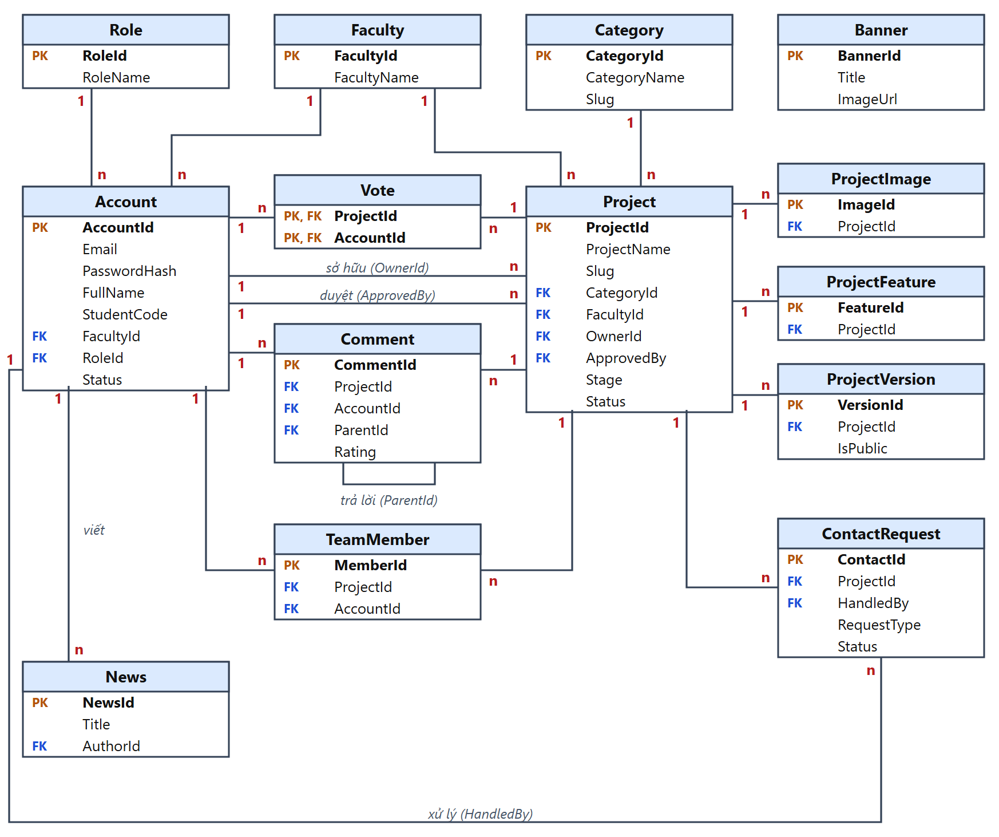

### 3.2.2. Lược đồ quan hệ

Lược đồ quan hệ của hệ thống như sau (thuộc tính **in đậm** là khóa chính, thuộc tính *in nghiêng* là khóa ngoại):

- Role(**RoleId**, RoleName, Description)
- Faculty(**FacultyId**, FacultyName, Description, DisplayOrder)
- Account(**AccountId**, Email, PasswordHash, FullName, StudentCode, ClassName, Phone, Avatar, *FacultyId*, *RoleId*, Status, CreatedAt, UpdatedAt)
- Category(**CategoryId**, CategoryName, Slug, Icon, Description, DisplayOrder, IsActive)
- Project(**ProjectId**, ProjectName, Slug, Slogan, ShortDescription, Content, Logo, CoverImage, VideoUrl, WebsiteUrl, CommunityUrl, *CategoryId*, *FacultyId*, *OwnerId*, Stage, Status, RejectReason, IsFeatured, ViewCount, FoundedDate, CreatedAt, UpdatedAt, ApprovedAt, *ApprovedBy*)
- ProjectImage(**ImageId**, *ProjectId*, ImageUrl, Caption, DisplayOrder)
- ProjectFeature(**FeatureId**, *ProjectId*, Title, Description, Icon, DisplayOrder)
- ProjectVersion(**VersionId**, *ProjectId*, VersionName, Platform, ReleaseDate, ChangeLog, DownloadUrl, IsPublic)
- TeamMember(**MemberId**, *ProjectId*, *AccountId*, FullName, Position, StudentCode, ClassName, Avatar, Email, DisplayOrder)
- Comment(**CommentId**, *ProjectId*, *AccountId*, *ParentId*, Content, Rating, IsHidden, CreatedAt)
- Vote(***ProjectId***, ***AccountId***, CreatedAt)
- ContactRequest(**ContactId**, *ProjectId*, FullName, Email, Phone, Organization, RequestType, Message, Status, CreatedAt, *HandledBy*)
- News(**NewsId**, Title, Slug, Thumbnail, Summary, Content, NewsType, EventDate, Location, *AuthorId*, IsPublished, ViewCount, CreatedAt, UpdatedAt)
- Banner(**BannerId**, Title, ImageUrl, LinkUrl, DisplayOrder, IsActive)

### 3.2.3. Mô tả chi tiết các bảng

Quy ước trong các bảng mô tả: PK – khóa chính, FK – khóa ngoại, UQ – giá trị duy nhất; cột “Null” đánh dấu ✓ nếu cho phép để trống.

Bảng 3.12. Bảng Role – vai trò

| Thuộc tính | Kiểu dữ liệu | Null | Ràng buộc | Mô tả |
|---|---|---|---|---|
| RoleId | int | | PK, tự tăng | Mã vai trò |
| RoleName | nvarchar(50) | | UQ | Tên vai trò dùng khi phân quyền: Admin, SinhVien |
| Description | nvarchar(200) | ✓ | | Mô tả quyền hạn |

Bảng 3.13. Bảng Faculty – khoa

| Thuộc tính | Kiểu dữ liệu | Null | Ràng buộc | Mô tả |
|---|---|---|---|---|
| FacultyId | int | | PK, tự tăng | Mã khoa |
| FacultyName | nvarchar(150) | | UQ | Tên khoa |
| Description | nvarchar(500) | ✓ | | Mô tả |
| DisplayOrder | int | | Mặc định 0 | Thứ tự hiển thị trong bộ lọc |

Bảng 3.14. Bảng Account – tài khoản

| Thuộc tính | Kiểu dữ liệu | Null | Ràng buộc | Mô tả |
|---|---|---|---|---|
| AccountId | int | | PK, tự tăng | Mã tài khoản |
| Email | varchar(100) | | UQ | Email đăng nhập, lưu chữ thường |
| PasswordHash | varchar(200) | | | Mật khẩu đã băm (PBKDF2 + salt) |
| FullName | nvarchar(100) | | | Họ và tên |
| StudentCode | varchar(20) | ✓ | | Mã số sinh viên |
| ClassName | nvarchar(50) | ✓ | | Lớp |
| Phone | varchar(15) | ✓ | | Số điện thoại |
| Avatar | nvarchar(255) | ✓ | | Đường dẫn ảnh đại diện |
| FacultyId | int | ✓ | FK → Faculty | Khoa của sinh viên |
| RoleId | int | | FK → Role | Vai trò |
| Status | tinyint | | Mặc định 1 | 1 – Hoạt động, 2 – Bị khóa |
| CreatedAt | datetime | | Mặc định GETDATE() | Ngày tạo |
| UpdatedAt | datetime | ✓ | | Ngày cập nhật |

Bảng 3.15. Bảng Category – lĩnh vực

| Thuộc tính | Kiểu dữ liệu | Null | Ràng buộc | Mô tả |
|---|---|---|---|---|
| CategoryId | int | | PK, tự tăng | Mã lĩnh vực |
| CategoryName | nvarchar(100) | | UQ | Tên lĩnh vực |
| Slug | varchar(120) | | UQ | Chuỗi không dấu dùng trên URL |
| Icon | nvarchar(100) | ✓ | | Tên biểu tượng (Bootstrap Icons) |
| Description | nvarchar(500) | ✓ | | Mô tả |
| DisplayOrder | int | | Mặc định 0 | Thứ tự hiển thị |
| IsActive | bit | | Mặc định 1 | Đang sử dụng hay không |

Bảng 3.16. Bảng Project – dự án khởi nghiệp

| Thuộc tính | Kiểu dữ liệu | Null | Ràng buộc | Mô tả |
|---|---|---|---|---|
| ProjectId | int | | PK, tự tăng | Mã dự án |
| ProjectName | nvarchar(150) | | | Tên dự án / sản phẩm |
| Slug | varchar(170) | | UQ | Đường dẫn thân thiện, sinh từ tên dự án |
| Slogan | nvarchar(200) | ✓ | | Khẩu hiệu |
| ShortDescription | nvarchar(500) | | | Mô tả ngắn hiển thị trên thẻ dự án |
| Content | nvarchar(MAX) | ✓ | | Giới thiệu chi tiết (HTML đã lọc) |
| Logo | nvarchar(255) | ✓ | | Đường dẫn logo |
| CoverImage | nvarchar(255) | ✓ | | Đường dẫn ảnh bìa |
| VideoUrl | nvarchar(255) | ✓ | | Video YouTube giới thiệu |
| WebsiteUrl | nvarchar(255) | ✓ | | Trang sản phẩm |
| CommunityUrl | nvarchar(255) | ✓ | | Fanpage / nhóm cộng đồng |
| CategoryId | int | | FK → Category | Lĩnh vực |
| FacultyId | int | | FK → Faculty | Khoa |
| OwnerId | int | | FK → Account | Sinh viên sở hữu dự án |
| Stage | tinyint | | Mặc định 1 | Giai đoạn: 1 – Ý tưởng, 2 – Nguyên mẫu, 3 – Đã ra mắt, 4 – Đang tăng trưởng |
| Status | tinyint | | Mặc định 0 | Trạng thái: 0 – Nháp, 1 – Chờ duyệt, 2 – Đã duyệt, 3 – Bị từ chối, 4 – Ẩn |
| RejectReason | nvarchar(500) | ✓ | | Lý do từ chối |
| IsFeatured | bit | | Mặc định 0 | Dự án nổi bật |
| ViewCount | int | | Mặc định 0 | Lượt xem |
| FoundedDate | date | ✓ | | Ngày bắt đầu dự án |
| CreatedAt | datetime | | Mặc định GETDATE() | Ngày tạo |
| UpdatedAt | datetime | ✓ | | Ngày cập nhật |
| ApprovedAt | datetime | ✓ | | Thời điểm duyệt |
| ApprovedBy | int | ✓ | FK → Account | Quản trị viên duyệt |

Bảng 3.17. Bảng ProjectImage – hình ảnh dự án

| Thuộc tính | Kiểu dữ liệu | Null | Ràng buộc | Mô tả |
|---|---|---|---|---|
| ImageId | int | | PK, tự tăng | Mã ảnh |
| ProjectId | int | | FK → Project (xóa theo) | Dự án |
| ImageUrl | nvarchar(255) | | | Đường dẫn ảnh |
| Caption | nvarchar(200) | ✓ | | Chú thích |
| DisplayOrder | int | | Mặc định 0 | Thứ tự hiển thị |

Bảng 3.18. Bảng ProjectFeature – tính năng nổi bật

| Thuộc tính | Kiểu dữ liệu | Null | Ràng buộc | Mô tả |
|---|---|---|---|---|
| FeatureId | int | | PK, tự tăng | Mã tính năng |
| ProjectId | int | | FK → Project (xóa theo) | Dự án |
| Title | nvarchar(150) | | | Tên tính năng |
| Description | nvarchar(500) | ✓ | | Mô tả |
| Icon | nvarchar(100) | ✓ | | Biểu tượng |
| DisplayOrder | int | | Mặc định 0 | Thứ tự hiển thị |

Bảng 3.19. Bảng ProjectVersion – phiên bản phát hành

| Thuộc tính | Kiểu dữ liệu | Null | Ràng buộc | Mô tả |
|---|---|---|---|---|
| VersionId | int | | PK, tự tăng | Mã phiên bản |
| ProjectId | int | | FK → Project (xóa theo) | Dự án |
| VersionName | nvarchar(100) | | | Tên phiên bản |
| Platform | nvarchar(100) | ✓ | | Nền tảng (Web, Android, Windows…) |
| ReleaseDate | date | ✓ | | Ngày phát hành |
| ChangeLog | nvarchar(MAX) | ✓ | | Nội dung thay đổi |
| DownloadUrl | nvarchar(255) | ✓ | | Đường dẫn tải về |
| IsPublic | bit | | Mặc định 1 | 1 – Công khai; 0 – Nội bộ (chỉ chủ dự án và Quản trị viên thấy) |

Bảng 3.20. Bảng TeamMember – thành viên nhóm

| Thuộc tính | Kiểu dữ liệu | Null | Ràng buộc | Mô tả |
|---|---|---|---|---|
| MemberId | int | | PK, tự tăng | Mã thành viên |
| ProjectId | int | | FK → Project (xóa theo) | Dự án |
| AccountId | int | ✓ | FK → Account | Tài khoản liên kết (nếu thành viên có tài khoản) |
| FullName | nvarchar(100) | | | Họ tên |
| Position | nvarchar(100) | ✓ | | Vai trò trong nhóm |
| StudentCode | varchar(20) | ✓ | | Mã số sinh viên |
| ClassName | nvarchar(50) | ✓ | | Lớp |
| Avatar | nvarchar(255) | ✓ | | Ảnh đại diện |
| Email | varchar(100) | ✓ | | Email |
| DisplayOrder | int | | Mặc định 0 | Thứ tự hiển thị |

Bảng 3.21. Bảng Comment – bình luận, đánh giá

| Thuộc tính | Kiểu dữ liệu | Null | Ràng buộc | Mô tả |
|---|---|---|---|---|
| CommentId | int | | PK, tự tăng | Mã bình luận |
| ProjectId | int | | FK → Project (xóa theo) | Dự án |
| AccountId | int | | FK → Account | Người viết |
| ParentId | int | ✓ | FK → Comment | Bình luận được trả lời (rỗng nếu là bình luận gốc) |
| Content | nvarchar(1000) | | | Nội dung |
| Rating | tinyint | ✓ | CHECK 1–5 | Số sao đánh giá |
| IsHidden | bit | | Mặc định 0 | Bị Quản trị viên ẩn |
| CreatedAt | datetime | | Mặc định GETDATE() | Thời điểm gửi |

Bảng 3.22. Bảng Vote – bình chọn

| Thuộc tính | Kiểu dữ liệu | Null | Ràng buộc | Mô tả |
|---|---|---|---|---|
| ProjectId | int | | PK, FK → Project (xóa theo) | Dự án được bình chọn |
| AccountId | int | | PK, FK → Account | Tài khoản bình chọn |
| CreatedAt | datetime | | Mặc định GETDATE() | Thời điểm bình chọn |

Bảng 3.23. Bảng ContactRequest – yêu cầu liên hệ

| Thuộc tính | Kiểu dữ liệu | Null | Ràng buộc | Mô tả |
|---|---|---|---|---|
| ContactId | int | | PK, tự tăng | Mã liên hệ |
| ProjectId | int | ✓ | FK → Project (đặt NULL khi xóa dự án) | Dự án được liên hệ; rỗng nếu là liên hệ chung |
| FullName | nvarchar(100) | | | Họ tên người gửi |
| Email | varchar(100) | | | Email người gửi |
| Phone | varchar(15) | ✓ | | Số điện thoại |
| Organization | nvarchar(150) | ✓ | | Đơn vị / doanh nghiệp |
| RequestType | tinyint | | | 1 – Hợp tác, 2 – Đầu tư, 3 – Sử dụng sản phẩm, 4 – Khác |
| Message | nvarchar(2000) | | | Nội dung |
| Status | tinyint | | Mặc định 0 | 0 – Mới, 1 – Đã liên hệ, 2 – Đã đóng |
| CreatedAt | datetime | | Mặc định GETDATE() | Thời điểm gửi |
| HandledBy | int | ✓ | FK → Account | Người xử lý |

Bảng 3.24. Bảng News – tin tức, sự kiện

| Thuộc tính | Kiểu dữ liệu | Null | Ràng buộc | Mô tả |
|---|---|---|---|---|
| NewsId | int | | PK, tự tăng | Mã bài viết |
| Title | nvarchar(200) | | | Tiêu đề |
| Slug | varchar(220) | | UQ | Đường dẫn thân thiện |
| Thumbnail | nvarchar(255) | ✓ | | Ảnh đại diện |
| Summary | nvarchar(500) | ✓ | | Tóm tắt |
| Content | nvarchar(MAX) | | | Nội dung (HTML đã lọc) |
| NewsType | tinyint | | Mặc định 1 | 1 – Tin tức, 2 – Sự kiện, 3 – Cuộc thi |
| EventDate | datetime | ✓ | | Thời gian diễn ra sự kiện |
| Location | nvarchar(200) | ✓ | | Địa điểm |
| AuthorId | int | | FK → Account | Người viết |
| IsPublished | bit | | Mặc định 0 | Đã xuất bản |
| ViewCount | int | | Mặc định 0 | Lượt xem |
| CreatedAt | datetime | | Mặc định GETDATE() | Ngày tạo |
| UpdatedAt | datetime | ✓ | | Ngày cập nhật |

Bảng 3.25. Bảng Banner – banner trang chủ

| Thuộc tính | Kiểu dữ liệu | Null | Ràng buộc | Mô tả |
|---|---|---|---|---|
| BannerId | int | | PK, tự tăng | Mã banner |
| Title | nvarchar(150) | ✓ | | Tiêu đề |
| ImageUrl | nvarchar(255) | | | Đường dẫn ảnh |
| LinkUrl | nvarchar(255) | ✓ | | Đường dẫn khi bấm vào banner |
| DisplayOrder | int | | Mặc định 0 | Thứ tự trình chiếu |
| IsActive | bit | | Mặc định 1 | Đang hiển thị hay không |

### 3.2.4. Ràng buộc toàn vẹn và quy tắc nghiệp vụ

Ngoài ràng buộc khóa chính, khóa ngoại, giá trị duy nhất và ràng buộc kiểm tra (CHECK) đã nêu trong các bảng, hệ thống áp dụng các quy tắc xóa dữ liệu như Bảng 3.26 để bảo đảm toàn vẹn dữ liệu.

Bảng 3.26. Hành vi khi xóa dữ liệu theo khóa ngoại

| Quan hệ | Hành vi khi xóa bản ghi cha |
|---|---|
| Project → ProjectImage, ProjectFeature, ProjectVersion, TeamMember, Comment, Vote | Xóa theo (CASCADE) |
| Project → ContactRequest | Giữ lại yêu cầu liên hệ, đặt ProjectId về NULL (SET NULL) |
| Category, Faculty, Account (chủ dự án) → Project | Không cho xóa (NO ACTION); ứng dụng báo lỗi cho người dùng |
| Comment → Comment (câu trả lời) | Xóa câu trả lời ở tầng ứng dụng, vì SQL Server không cho phép xóa theo trên quan hệ tự tham chiếu |

Các quy tắc nghiệp vụ chính gắn với dữ liệu:

- Chỉ dự án có trạng thái Đã duyệt (Status = 2) mới hiển thị ở trang người dùng; phiên bản có IsPublic = 0 chỉ chủ dự án và Quản trị viên nhìn thấy.
- Sinh viên chỉ được gửi duyệt khi dự án có ảnh bìa và ít nhất một tính năng; chỉ được xóa dự án đang ở trạng thái Nháp hoặc Bị từ chối.
- Mỗi tài khoản chỉ bình chọn và chấm sao một lần cho mỗi dự án; không tự bình chọn, chấm sao dự án của chính mình.
- Chỉ chủ dự án và Quản trị viên được trả lời bình luận; chỉ dự án đã duyệt mới được đánh dấu nổi bật.

## 3.3. Thiết kế chức năng

### 3.3.1. Sơ đồ tuần tự

**Chức năng Đăng nhập.** Hình 3.3 mô tả trình tự xử lý khi người dùng đăng nhập. Sau khi dữ liệu được kiểm tra hợp lệ ở phía trình duyệt, yêu cầu được gửi tới `AccountController` kèm token chống giả mạo. Controller truy vấn tài khoản qua `AppDbContext`, dùng dịch vụ `IPasswordHasher` để so khớp mật khẩu với chuỗi băm. Có ba nhánh xử lý: sai thông tin đăng nhập, tài khoản bị khóa và đăng nhập hợp lệ. Ở nhánh hợp lệ, hệ thống tạo danh sách thông tin định danh (claims) gồm mã tài khoản, họ tên, email, vai trò và ghi vào cookie, sau đó chuyển hướng theo vai trò.

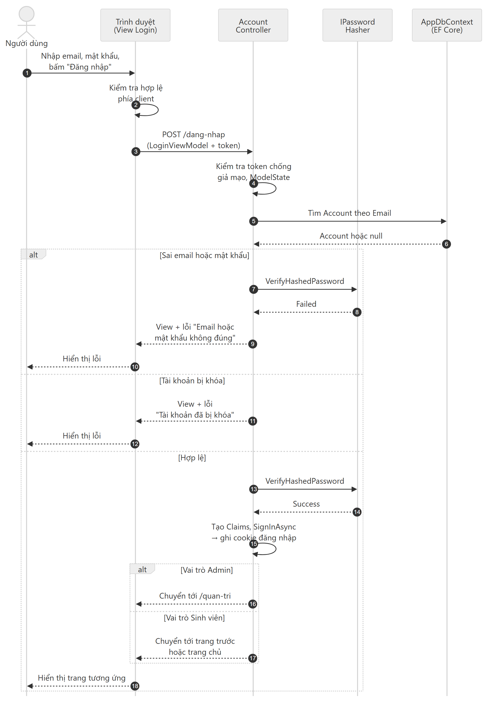

**Chức năng Đăng dự án và gửi duyệt.** Hình 3.4 thể hiện quá trình sinh viên tạo dự án. `MyProjectsController` chỉ cho phép vai trò Sinh viên truy cập; khi nhận dữ liệu, controller kiểm tra lĩnh vực, khoa hợp lệ, tạo đường dẫn không trùng, gọi các dịch vụ lọc HTML và lưu ảnh, rồi lưu dự án ở trạng thái Nháp. Sinh viên tiếp tục bổ sung nội dung (vòng lặp), cuối cùng gửi duyệt; hệ thống kiểm tra điều kiện có ảnh bìa và tính năng trước khi chuyển trạng thái Chờ duyệt.

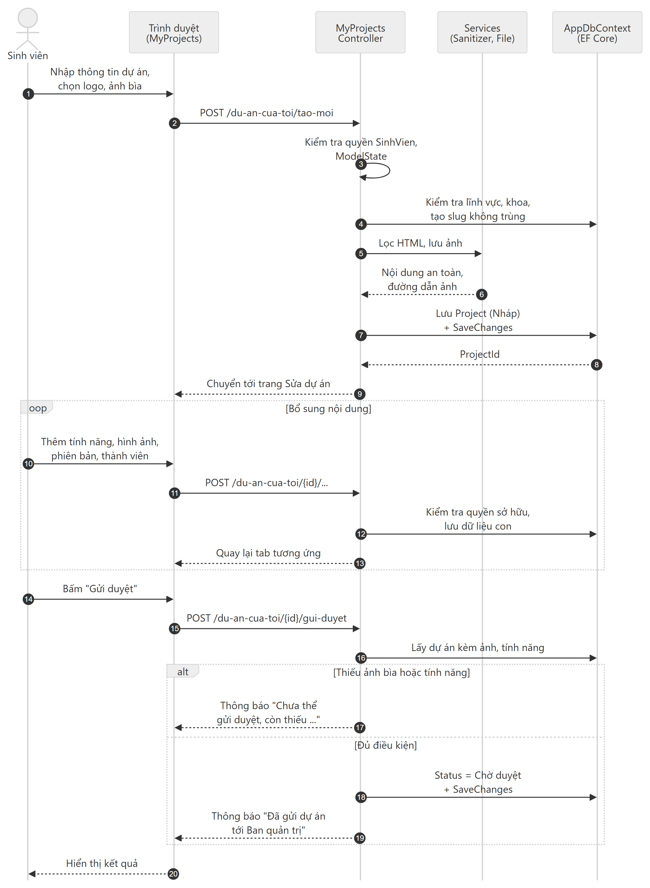

**Chức năng Duyệt dự án.** Hình 3.5 mô tả cách Quản trị viên duyệt dự án. Quản trị viên được phép xem trước trang của dự án chưa công khai để kiểm tra nội dung. Khi duyệt, hệ thống ghi nhận thời điểm và người duyệt; khi từ chối, lý do là bắt buộc và được lưu lại để sinh viên chỉnh sửa.

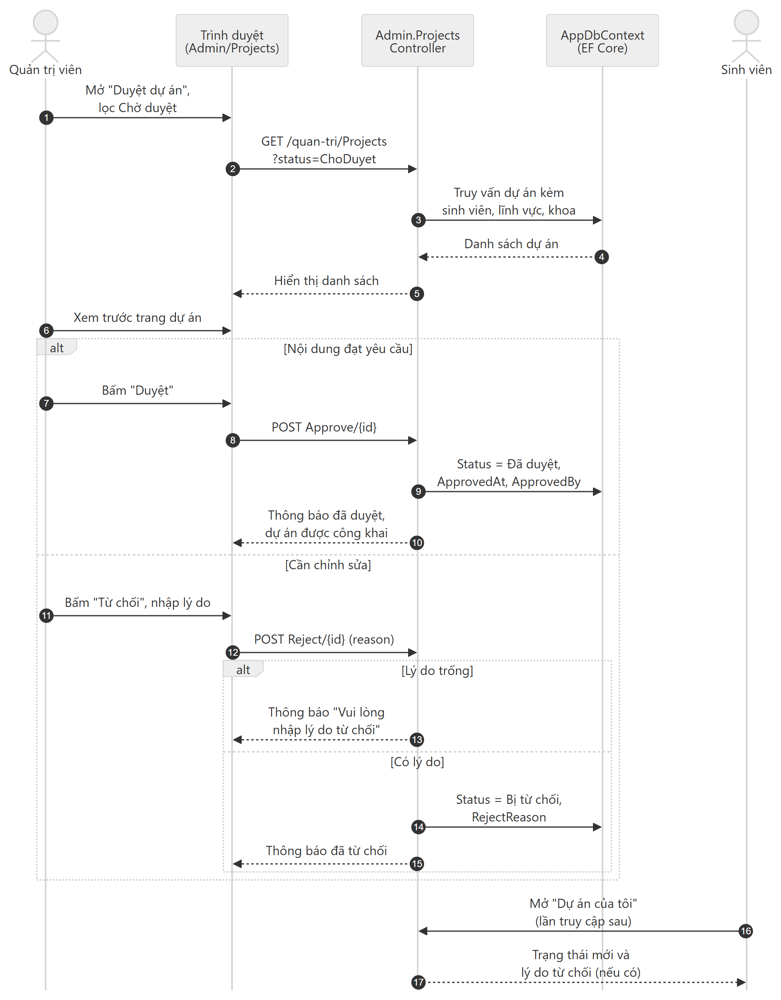

### 3.3.2. Sơ đồ trạng thái

Mỗi dự án có một vòng đời gồm năm trạng thái, tương ứng giá trị cột Status trong bảng Project (Hình 3.6):

- **Nháp (0):** trạng thái ban đầu khi sinh viên tạo dự án; sinh viên được sửa, xóa.
- **Chờ duyệt (1):** sau khi sinh viên gửi duyệt và dự án đủ điều kiện; sinh viên có thể rút lại về Nháp.
- **Đã duyệt (2):** Quản trị viên duyệt, dự án hiển thị công khai; sinh viên vẫn cập nhật được nội dung.
- **Bị từ chối (3):** Quản trị viên từ chối kèm lý do; sinh viên sửa và gửi duyệt lại.
- **Ẩn (4):** Quản trị viên tạm ẩn dự án đã duyệt (ví dụ khi có phản ánh vi phạm) và có thể hiện lại.

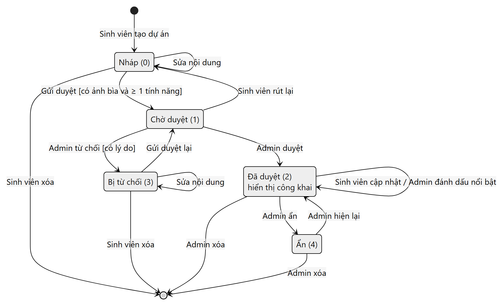

Các quy tắc chuyển trạng thái được cài đặt tập trung trong lớp `ProjectRules` (các hàm `CanEdit`, `CanDelete`, `CanSubmit`, `CanWithdraw`), giúp controller và giao diện dùng chung một logic.

### 3.3.3. Sơ đồ hoạt động

**Quy trình đăng dự án đến khi công khai.** Sơ đồ hoạt động ở Hình 3.7 chia thành ba làn tương ứng ba đối tượng tham gia: Sinh viên, Hệ thống và Quản trị viên. Quy trình có ba điểm quyết định: kiểm tra dữ liệu hợp lệ khi lưu, kiểm tra điều kiện gửi duyệt, và quyết định duyệt hay từ chối của Quản trị viên. Nhánh từ chối quay lại để sinh viên chỉnh sửa và gửi duyệt lại; nhánh duyệt kết thúc khi dự án được hiển thị công khai.

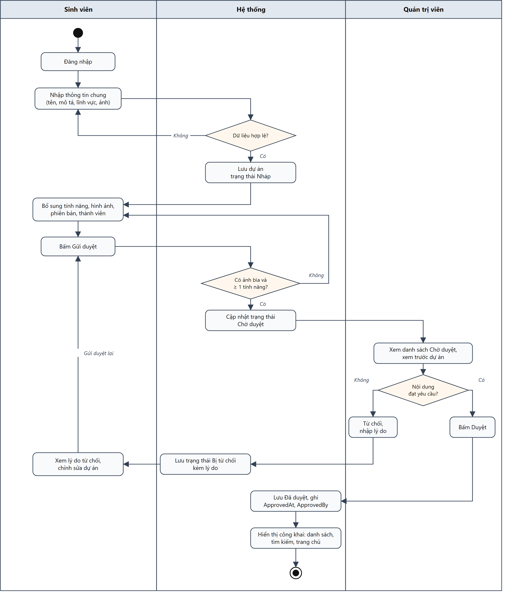

**Quy trình gửi liên hệ hợp tác.** Hình 3.8 mô tả luồng từ khi khách tìm thấy dự án, gửi yêu cầu liên hệ, đến khi sinh viên chủ dự án hoặc Quản trị viên xử lý. Hệ thống kiểm tra token chống giả mạo và dữ liệu nhập trước khi lưu; yêu cầu hợp lệ được lưu ở trạng thái Mới và được thông báo tới cả người gửi lẫn người xử lý.

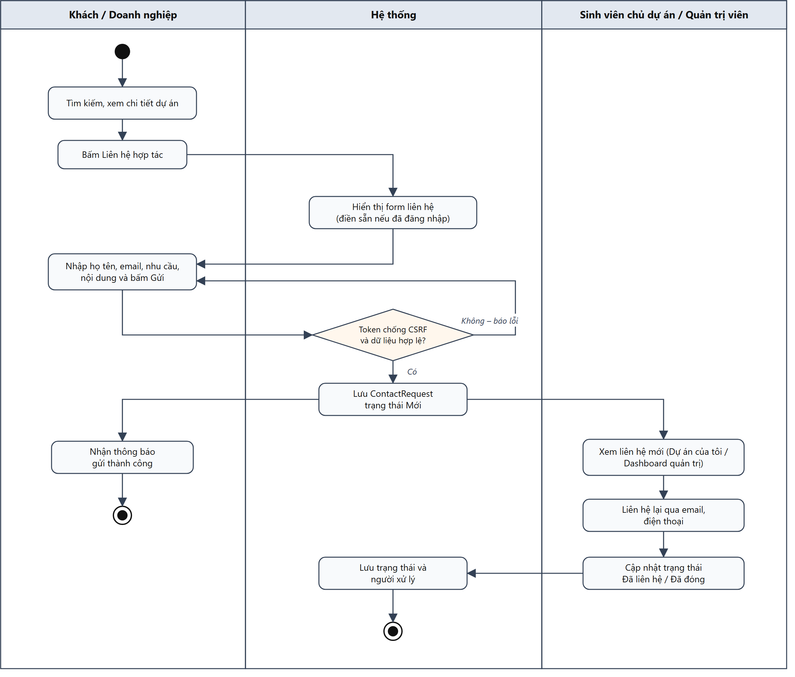

## 3.4. Thiết kế kiến trúc và giao diện

### 3.4.1. Kiến trúc hệ thống

Hệ thống được xây dựng theo mô hình MVC (Model – View – Controller) của ASP.NET Core, kết hợp phân lớp truy cập dữ liệu và lớp dịch vụ (Hình 3.9). Một yêu cầu HTTP từ trình duyệt lần lượt đi qua chuỗi middleware: phục vụ tệp tĩnh, định tuyến, xác thực và phân quyền. Sau đó yêu cầu đến controller tương ứng; controller sử dụng các dịch vụ được cung cấp qua cơ chế Dependency Injection, truy cập dữ liệu thông qua `AppDbContext` (Entity Framework Core) và truyền ViewModel sang View Razor để sinh HTML trả về trình duyệt.

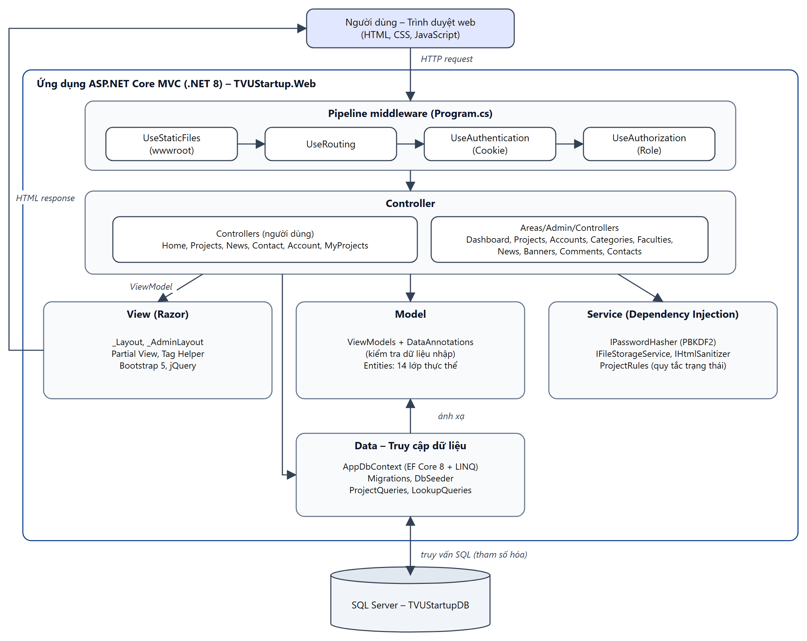

Bảng 3.27. Các thành phần trong kiến trúc hệ thống

| Lớp | Thành phần trong dự án | Nhiệm vụ |
|---|---|---|
| Middleware | `Program.cs`: StaticFiles, Routing, Authentication, Authorization | Xử lý yêu cầu trước khi đến controller |
| Controller | `Controllers/*` (người dùng), `Areas/Admin/Controllers/*` (quản trị) | Nhận yêu cầu, kiểm tra quyền, gọi dữ liệu và dịch vụ, chọn View |
| Model | `Models/Entities` (ánh xạ bảng), `Models/ViewModels` (dữ liệu cho View, kiểm tra nhập liệu bằng DataAnnotations) | Mô tả dữ liệu |
| View | `Views/*`, `Areas/Admin/Views/*` (Razor, Layout, Partial View, Tag Helper) | Sinh giao diện HTML |
| Service | `FileStorageService`, `ProjectRules`, `IPasswordHasher`, `IHtmlSanitizer` | Xử lý nghiệp vụ dùng chung |
| Data | `AppDbContext`, `Migrations`, `DbSeeder`, `ProjectQueries` | Truy cập SQL Server qua EF Core |

Khu vực quản trị được tách riêng thành Area `Admin` với layout riêng, tất cả controller trong khu vực này kế thừa lớp `AdminBaseController` được gắn thuộc tính `[Authorize(Roles = "Admin")]`, nhờ đó chỉ cần khai báo phân quyền ở một nơi.

Bảng 3.28. Tổ chức đường dẫn (URL) chính của hệ thống

| URL | Chức năng | Quyền truy cập |
|---|---|---|
| `/`, `/du-an`, `/du-an/{slug}` | Trang chủ, danh sách, chi tiết dự án | Mọi người |
| `/tin-tuc`, `/tin-tuc/{slug}`, `/lien-he` | Tin tức, liên hệ Ban quản trị | Mọi người |
| `/dang-nhap`, `/dang-ky`, `/dang-xuat` | Xác thực tài khoản | Mọi người |
| `/tai-khoan`, `/tai-khoan/doi-mat-khau` | Hồ sơ, đổi mật khẩu | Đã đăng nhập |
| `/du-an-cua-toi/...` | Quản lý dự án, liên hệ của sinh viên | Sinh viên |
| `/quan-tri/{Controller}/{Action}` | Khu vực quản trị | Quản trị viên |
| `/loi/{code}` | Trang báo lỗi 400, 403, 404 | Mọi người |

### 3.4.2. Thiết kế giao diện

Giao diện được thiết kế theo các nguyên tắc: bố cục rõ ràng, nhất quán giữa các trang; màu chủ đạo xanh dương đậm kết hợp màu cam làm điểm nhấn; ưu tiên hiển thị hình ảnh sản phẩm; tương thích với màn hình điện thoại. Trước khi lập trình, các màn hình chính được phác thảo dưới dạng wireframe (bản phác thảo đen trắng, chỉ thể hiện bố cục) như từ Hình 3.10 đến Hình 3.15.

- **Trang chủ (Hình 3.10):** phần đầu giới thiệu kèm ô tìm kiếm và bốn số liệu thống kê; tiếp theo là dự án nổi bật, các lĩnh vực, dự án mới nhất, banner sự kiện và tin tức.

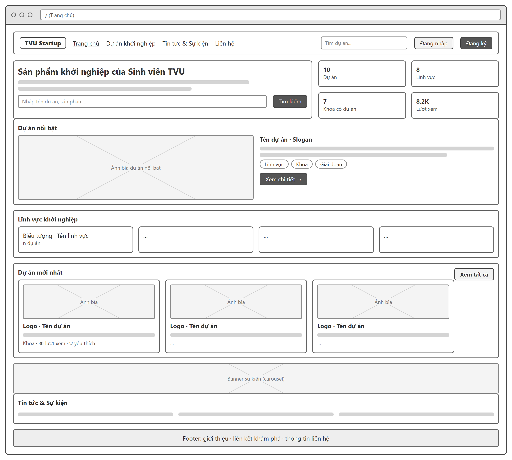

- **Danh sách dự án (Hình 3.11):** cột trái là bộ lọc (từ khóa, lĩnh vực, khoa, giai đoạn), cột phải là lưới thẻ dự án, ô sắp xếp và phân trang.

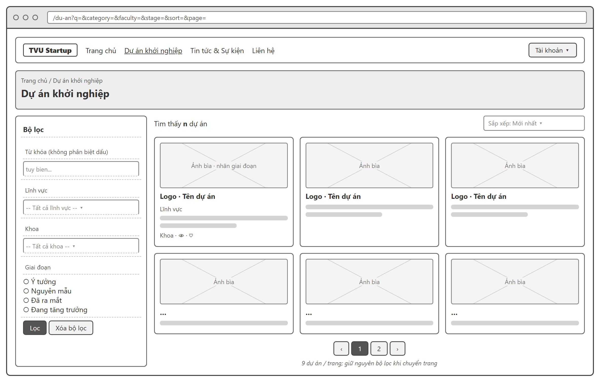

- **Chi tiết dự án (Hình 3.12):** phần đầu gồm logo, tên, slogan, các nhãn và nút hành động; cột chính gồm giới thiệu, tính năng, hình ảnh, bình luận; cột phụ gồm thông tin dự án, phiên bản và đội ngũ.

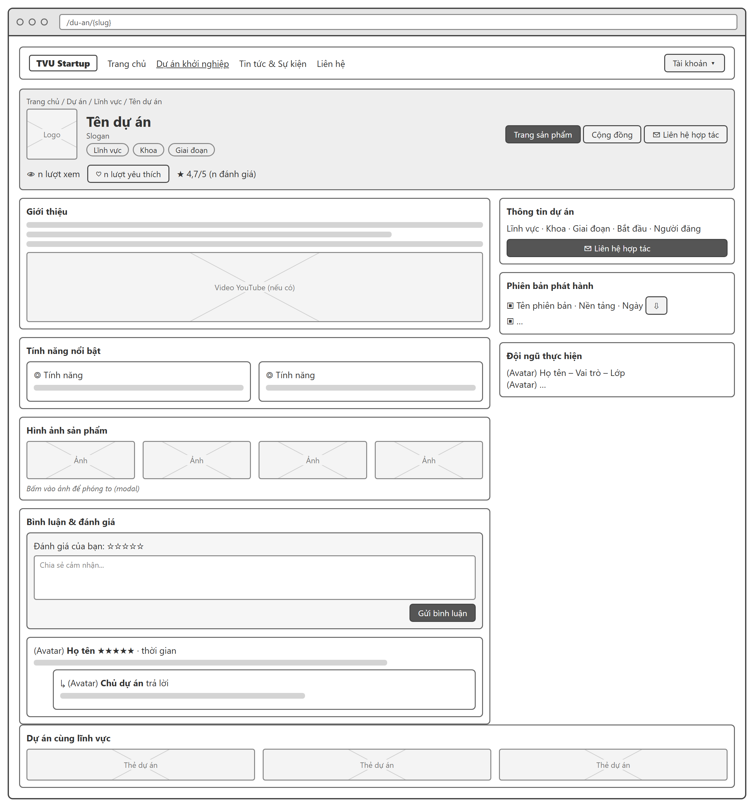

- **Đăng / sửa dự án (Hình 3.13):** các tab Thông tin chung, Tính năng, Hình ảnh, Phiên bản, Thành viên; thanh trạng thái phía trên kèm nút Xem trước và Gửi duyệt.

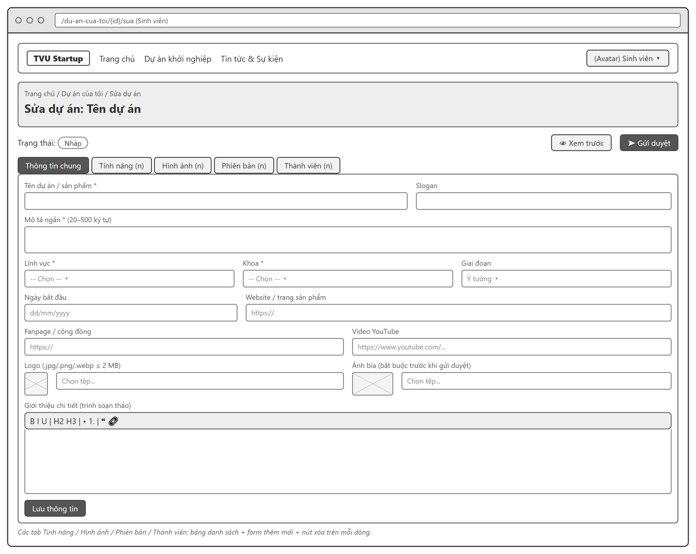

- **Duyệt dự án (Hình 3.14):** khu quản trị có thanh menu bên trái; bảng dự án lọc theo trạng thái với các nút Duyệt, Từ chối, Nổi bật, Ẩn, Xóa; hộp thoại nhập lý do khi từ chối.

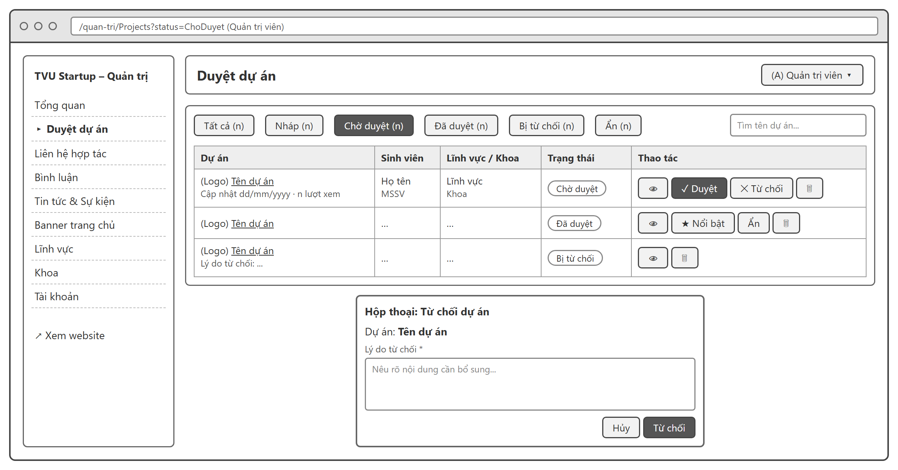

- **Dashboard (Hình 3.15):** các ô số liệu, bốn biểu đồ thống kê, danh sách dự án chờ duyệt, liên hệ mới và dự án được xem nhiều nhất.

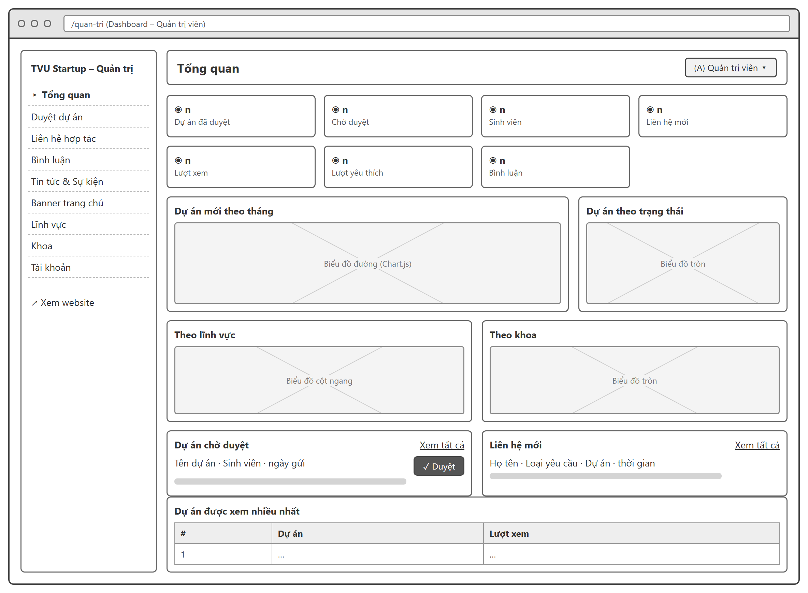

## Tiểu kết chương 3

Chương 3 đã xác định ba tác nhân và 24 chức năng của hệ thống, đặc tả chi tiết các use case chính; thiết kế cơ sở dữ liệu gồm 14 bảng với đầy đủ ràng buộc toàn vẹn; mô hình hóa các chức năng quan trọng bằng sơ đồ tuần tự, trạng thái, hoạt động; đồng thời xác định kiến trúc MVC phân lớp và bố cục giao diện các màn hình chính. Đây là cơ sở để cài đặt hệ thống được trình bày ở Chương 4.
