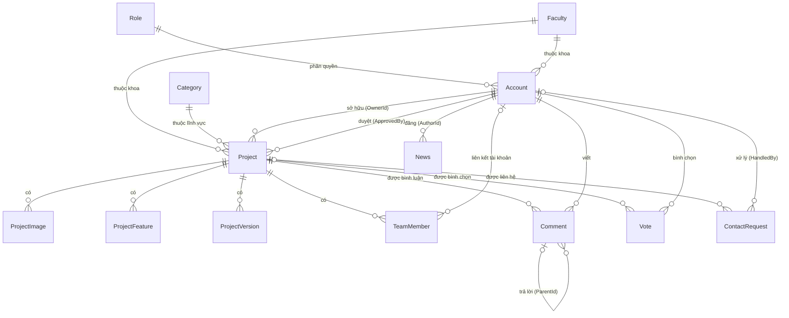

# THIẾT KẾ CƠ SỞ DỮ LIỆU

**Đề tài:** Xây dựng website giới thiệu các sản phẩm khởi nghiệp của Sinh viên Trường Đại học Trà Vinh
**Sinh viên thực hiện:** Lê Văn Bình Phương – MSSV 170125077 – Lớp DK25TTG2
**Hệ quản trị CSDL:** Microsoft SQL Server – **Tên CSDL:** `TVUStartupDB`
**Nền tảng:** ASP.NET Core MVC (.NET 8) – **Truy cập dữ liệu:** Entity Framework Core 8 – Code First (tự sinh bảng `__EFMigrationsHistory`)
**Máy chủ CSDL:** SQL Server 2022 Express – instance `.\SQLEXPRESS`

---

## 1. Danh sách các bảng

| STT | Tên bảng | Ý nghĩa |
|---|---|---|
| 1 | `__EFMigrationsHistory` | Lịch sử migration do Entity Framework Core tự tạo |
| 2 | `Role` | Vai trò / phân quyền tài khoản |
| 3 | `Faculty` | Khoa / đơn vị của Trường ĐH Trà Vinh |
| 4 | `Account` | Tài khoản người dùng (quản trị viên, sinh viên) |
| 5 | `Category` | Lĩnh vực của dự án khởi nghiệp |
| 6 | `Project` | Dự án / sản phẩm khởi nghiệp (bảng trung tâm) |
| 7 | `ProjectImage` | Thư viện hình ảnh của dự án |
| 8 | `ProjectFeature` | Các tính năng nổi bật của sản phẩm |
| 9 | `ProjectVersion` | Các phiên bản phát hành của sản phẩm |
| 10 | `TeamMember` | Thành viên đội ngũ thực hiện dự án |
| 11 | `Comment` | Bình luận và đánh giá (sao) của người dùng |
| 12 | `Vote` | Lượt bình chọn / yêu thích dự án |
| 13 | `ContactRequest` | Yêu cầu hợp tác, đầu tư, sử dụng sản phẩm |
| 14 | `News` | Tin tức, sự kiện, cuộc thi khởi nghiệp |
| 15 | `Banner` | Banner trình chiếu trên trang chủ |

## 2. Sơ đồ quan hệ

## 3. Mô tả chi tiết các bảng

> Quy ước: **PK** – khóa chính, **FK** – khóa ngoại, **UQ** – duy nhất, ✓ – cho phép rỗng.

### Bảng 1: `__EFMigrationsHistory`

| Tên thuộc tính | Kiểu dữ liệu (độ dài) | Cho phép rỗng | Ràng buộc |
|---|---|---|---|
| MigrationId | nvarchar(150) | | PK |
| ProductVersion | nvarchar(32) | | |

- Bảng do Entity Framework Core tự sinh, lưu lịch sử các migration đã áp dụng vào CSDL. Không thao tác trực tiếp.

### Bảng 2: `Role`

| Tên thuộc tính | Kiểu dữ liệu (độ dài) | Cho phép rỗng | Ràng buộc |
|---|---|---|---|
| RoleId | int | | PK, tự tăng |
| RoleName | nvarchar(50) | | UQ |
| Description | nvarchar(200) | ✓ | |

- **RoleId**: mã vai trò.
- **RoleName**: mã vai trò dùng trong phân quyền. Dữ liệu mặc định: `1 – Admin` (Quản trị viên), `2 – SinhVien` (Sinh viên).
- **Description**: mô tả quyền hạn.

### Bảng 3: `Faculty`

| Tên thuộc tính | Kiểu dữ liệu (độ dài) | Cho phép rỗng | Ràng buộc |
|---|---|---|---|
| FacultyId | int | | PK, tự tăng |
| FacultyName | nvarchar(150) | | UQ |
| Description | nvarchar(500) | ✓ | |
| DisplayOrder | int | | Mặc định 0 |

- **FacultyName**: tên khoa (VD: Khoa Kỹ thuật và Công nghệ, Khoa Kinh tế – Luật…).
- **DisplayOrder**: thứ tự hiển thị trong bộ lọc.

### Bảng 4: `Account`

| Tên thuộc tính | Kiểu dữ liệu (độ dài) | Cho phép rỗng | Ràng buộc |
|---|---|---|---|
| AccountId | int | | PK, tự tăng |
| Email | varchar(100) | | UQ |
| PasswordHash | varchar(200) | | |
| FullName | nvarchar(100) | | |
| StudentCode | varchar(20) | ✓ | |
| ClassName | nvarchar(50) | ✓ | |
| Phone | varchar(15) | ✓ | |
| Avatar | nvarchar(255) | ✓ | |
| FacultyId | int | ✓ | FK → Faculty |
| RoleId | int | | FK → Role |
| Status | tinyint | | Mặc định 1 |
| CreatedAt | datetime | | Mặc định GETDATE() |
| UpdatedAt | datetime | ✓ | |

- **Email**: dùng để đăng nhập (duy nhất, lưu chữ thường).
- **PasswordHash**: mật khẩu đã băm bằng `PasswordHasher` của ASP.NET Core (PBKDF2 + salt ngẫu nhiên, chuỗi Base64 ~84 ký tự), không lưu mật khẩu gốc.
- **StudentCode / ClassName**: MSSV và lớp (chỉ áp dụng cho sinh viên).
- **Status**: `1` – hoạt động, `2` – bị khóa (không đăng nhập được, đang đăng nhập sẽ bị đăng xuất).

### Bảng 5: `Category`

| Tên thuộc tính | Kiểu dữ liệu (độ dài) | Cho phép rỗng | Ràng buộc |
|---|---|---|---|
| CategoryId | int | | PK, tự tăng |
| CategoryName | nvarchar(100) | | UQ |
| Slug | varchar(120) | | UQ |
| Icon | nvarchar(100) | ✓ | |
| Description | nvarchar(500) | ✓ | |
| DisplayOrder | int | | Mặc định 0 |
| IsActive | bit | | Mặc định 1 |

- **CategoryName**: tên lĩnh vực (Công nghệ phần mềm, Nông nghiệp công nghệ cao, Thực phẩm, Giáo dục, Môi trường, Dịch vụ…).
- **Slug**: chuỗi không dấu dùng trên URL (VD: `cong-nghe-phan-mem`).
- **Icon**: tên class biểu tượng (Bootstrap Icons / Font Awesome).

### Bảng 6: `Project`

| Tên thuộc tính | Kiểu dữ liệu (độ dài) | Cho phép rỗng | Ràng buộc |
|---|---|---|---|
| ProjectId | int | | PK, tự tăng |
| ProjectName | nvarchar(150) | | |
| Slug | varchar(170) | | UQ |
| Slogan | nvarchar(200) | ✓ | |
| ShortDescription | nvarchar(500) | | |
| Content | nvarchar(MAX) | ✓ | |
| Logo | nvarchar(255) | ✓ | |
| CoverImage | nvarchar(255) | ✓ | |
| VideoUrl | nvarchar(255) | ✓ | |
| WebsiteUrl | nvarchar(255) | ✓ | |
| CommunityUrl | nvarchar(255) | ✓ | |
| CategoryId | int | | FK → Category |
| FacultyId | int | | FK → Faculty |
| OwnerId | int | | FK → Account |
| Stage | tinyint | | Mặc định 1 |
| Status | tinyint | | Mặc định 0 |
| RejectReason | nvarchar(500) | ✓ | |
| IsFeatured | bit | | Mặc định 0 |
| ViewCount | int | | Mặc định 0 |
| FoundedDate | date | ✓ | |
| CreatedAt | datetime | | Mặc định GETDATE() |
| UpdatedAt | datetime | ✓ | |
| ApprovedAt | datetime | ✓ | |
| ApprovedBy | int | ✓ | FK → Account |

- **ProjectName / Slogan / ShortDescription**: tên, khẩu hiệu và mô tả ngắn hiển thị trên thẻ dự án.
- **Content**: nội dung giới thiệu chi tiết (HTML, soạn bằng trình soạn thảo).
- **Logo / CoverImage / VideoUrl**: logo, ảnh bìa, video giới thiệu (YouTube).
- **WebsiteUrl / CommunityUrl**: trang chủ sản phẩm (VD: GitHub) và nhóm cộng đồng người dùng.
- **OwnerId**: sinh viên đăng dự án.
- **Stage** (giai đoạn): `1` – Ý tưởng, `2` – Nguyên mẫu (MVP), `3` – Đã ra mắt, `4` – Đang tăng trưởng.
- **Status** (trạng thái duyệt): `0` – Nháp, `1` – Chờ duyệt, `2` – Đã duyệt (hiển thị công khai), `3` – Bị từ chối, `4` – Ẩn.
- **RejectReason**: lý do quản trị viên từ chối.
- **IsFeatured**: dự án nổi bật trên trang chủ.
- **ViewCount**: lượt xem, tăng mỗi lần mở trang chi tiết.
- **ApprovedAt / ApprovedBy**: thời điểm và quản trị viên duyệt dự án.

### Bảng 7: `ProjectImage`

| Tên thuộc tính | Kiểu dữ liệu (độ dài) | Cho phép rỗng | Ràng buộc |
|---|---|---|---|
| ImageId | int | | PK, tự tăng |
| ProjectId | int | | FK → Project (xóa theo) |
| ImageUrl | nvarchar(255) | | |
| Caption | nvarchar(200) | ✓ | |
| DisplayOrder | int | | Mặc định 0 |

- Lưu ảnh chụp màn hình / hình ảnh sản phẩm. Khi xóa dự án thì xóa luôn ảnh (cascade).

### Bảng 8: `ProjectFeature`

| Tên thuộc tính | Kiểu dữ liệu (độ dài) | Cho phép rỗng | Ràng buộc |
|---|---|---|---|
| FeatureId | int | | PK, tự tăng |
| ProjectId | int | | FK → Project (xóa theo) |
| Title | nvarchar(150) | | |
| Description | nvarchar(500) | ✓ | |
| Icon | nvarchar(100) | ✓ | |
| DisplayOrder | int | | Mặc định 0 |

- Danh sách tính năng hiển thị dạng thẻ ở trang chi tiết (VD Zalord: “Tùy biến giao diện”, “Ẩn danh khi quay màn hình”…).

### Bảng 9: `ProjectVersion`

| Tên thuộc tính | Kiểu dữ liệu (độ dài) | Cho phép rỗng | Ràng buộc |
|---|---|---|---|
| VersionId | int | | PK, tự tăng |
| ProjectId | int | | FK → Project (xóa theo) |
| VersionName | nvarchar(100) | | |
| Platform | nvarchar(100) | ✓ | |
| ReleaseDate | date | ✓ | |
| ChangeLog | nvarchar(MAX) | ✓ | |
| DownloadUrl | nvarchar(255) | ✓ | |
| IsPublic | bit | | Mặc định 1 |

- **VersionName / Platform**: tên phiên bản và nền tảng (VD: `Zalord Small v3.6` – Zalo PC; `Zalord Elite` – Chrome Extension).
- **ChangeLog**: nội dung cập nhật của phiên bản.
- **IsPublic**: `1` – bản phát hành công khai, hiển thị trên website; `0` – bản nội bộ / nghiên cứu, chỉ quản trị viên và chủ dự án thấy (VD: Zalord Full / Premium).

### Bảng 10: `TeamMember`

| Tên thuộc tính | Kiểu dữ liệu (độ dài) | Cho phép rỗng | Ràng buộc |
|---|---|---|---|
| MemberId | int | | PK, tự tăng |
| ProjectId | int | | FK → Project (xóa theo) |
| AccountId | int | ✓ | FK → Account |
| FullName | nvarchar(100) | | |
| Position | nvarchar(100) | ✓ | |
| StudentCode | varchar(20) | ✓ | |
| ClassName | nvarchar(50) | ✓ | |
| Avatar | nvarchar(255) | ✓ | |
| Email | varchar(100) | ✓ | |
| DisplayOrder | int | | Mặc định 0 |

- **AccountId**: liên kết tới tài khoản nếu thành viên có tài khoản trên hệ thống (cho phép rỗng vì có thành viên không đăng ký).
- **Position**: vai trò trong nhóm (Trưởng nhóm, Lập trình viên, Thiết kế…).

### Bảng 11: `Comment`

| Tên thuộc tính | Kiểu dữ liệu (độ dài) | Cho phép rỗng | Ràng buộc |
|---|---|---|---|
| CommentId | int | | PK, tự tăng |
| ProjectId | int | | FK → Project (xóa theo) |
| AccountId | int | | FK → Account |
| ParentId | int | ✓ | FK → Comment |
| Content | nvarchar(1000) | | |
| Rating | tinyint | ✓ | CHECK 1–5 |
| IsHidden | bit | | Mặc định 0 |
| CreatedAt | datetime | | Mặc định GETDATE() |

- **ParentId**: rỗng nếu là bình luận gốc; có giá trị nếu là câu trả lời (chủ dự án trả lời người dùng).
- **Rating**: số sao đánh giá (1–5), chỉ áp dụng cho bình luận gốc. Điểm trung bình hiển thị trên trang dự án.
- **IsHidden**: quản trị viên ẩn bình luận vi phạm.

### Bảng 12: `Vote`

| Tên thuộc tính | Kiểu dữ liệu (độ dài) | Cho phép rỗng | Ràng buộc |
|---|---|---|---|
| ProjectId | int | | PK, FK → Project (xóa theo) |
| AccountId | int | | PK, FK → Account |
| CreatedAt | datetime | | Mặc định GETDATE() |

- Khóa chính ghép (ProjectId, AccountId) đảm bảo mỗi tài khoản chỉ bình chọn một dự án một lần. Bấm lại để bỏ bình chọn.

### Bảng 13: `ContactRequest`

| Tên thuộc tính | Kiểu dữ liệu (độ dài) | Cho phép rỗng | Ràng buộc |
|---|---|---|---|
| ContactId | int | | PK, tự tăng |
| ProjectId | int | ✓ | FK → Project |
| FullName | nvarchar(100) | | |
| Email | varchar(100) | | |
| Phone | varchar(15) | ✓ | |
| Organization | nvarchar(150) | ✓ | |
| RequestType | tinyint | | |
| Message | nvarchar(2000) | | |
| Status | tinyint | | Mặc định 0 |
| CreatedAt | datetime | | Mặc định GETDATE() |
| HandledBy | int | ✓ | FK → Account |

- **ProjectId**: dự án được liên hệ; rỗng nếu là liên hệ chung với ban quản trị website.
- **Organization**: đơn vị / doanh nghiệp của người liên hệ.
- **RequestType**: `1` – Hợp tác, `2` – Đầu tư, `3` – Sử dụng sản phẩm, `4` – Khác.
- **Status**: `0` – Mới, `1` – Đã liên hệ lại, `2` – Đã đóng.
- Khách không cần đăng nhập vẫn gửi được yêu cầu.

### Bảng 14: `News`

| Tên thuộc tính | Kiểu dữ liệu (độ dài) | Cho phép rỗng | Ràng buộc |
|---|---|---|---|
| NewsId | int | | PK, tự tăng |
| Title | nvarchar(200) | | |
| Slug | varchar(220) | | UQ |
| Thumbnail | nvarchar(255) | ✓ | |
| Summary | nvarchar(500) | ✓ | |
| Content | nvarchar(MAX) | | |
| NewsType | tinyint | | Mặc định 1 |
| EventDate | datetime | ✓ | |
| Location | nvarchar(200) | ✓ | |
| AuthorId | int | | FK → Account |
| IsPublished | bit | | Mặc định 0 |
| ViewCount | int | | Mặc định 0 |
| CreatedAt | datetime | | Mặc định GETDATE() |
| UpdatedAt | datetime | ✓ | |

- **NewsType**: `1` – Tin tức, `2` – Sự kiện, `3` – Cuộc thi khởi nghiệp.
- **EventDate / Location**: thời gian và địa điểm (dùng cho sự kiện / cuộc thi).
- **IsPublished**: chỉ bài đã xuất bản mới hiển thị ở trang người dùng.

### Bảng 15: `Banner`

| Tên thuộc tính | Kiểu dữ liệu (độ dài) | Cho phép rỗng | Ràng buộc |
|---|---|---|---|
| BannerId | int | | PK, tự tăng |
| Title | nvarchar(150) | ✓ | |
| ImageUrl | nvarchar(255) | | |
| LinkUrl | nvarchar(255) | ✓ | |
| DisplayOrder | int | | Mặc định 0 |
| IsActive | bit | | Mặc định 1 |

- Ảnh trình chiếu (carousel) ở đầu trang chủ, có thể trỏ tới một dự án hoặc bài tin tức.

## 4. Quy tắc nghiệp vụ gắn với CSDL

1. Chỉ dự án có `Status = 2` (Đã duyệt) mới hiển thị ở trang người dùng.
2. Sinh viên tạo dự án → `Status = 0` (Nháp) → bấm “Gửi duyệt” (cần có ảnh bìa và ít nhất 1 tính năng) → `Status = 1`. Khi đang chờ duyệt, sinh viên có thể “Rút lại” → `Status = 0`.
3. Admin duyệt → `Status = 2`, ghi `ApprovedAt`, `ApprovedBy`; từ chối → `Status = 3` kèm `RejectReason` (bắt buộc). Dự án bị từ chối được sửa và gửi duyệt lại.
3a. Sinh viên được sửa dự án ở trạng thái Nháp, Từ chối, Đã duyệt (dự án đã duyệt vẫn công khai khi cập nhật); chỉ được xóa dự án ở trạng thái Nháp hoặc Từ chối.
3b. Admin có thể ẩn dự án đã duyệt (`Status = 4`) và hiện lại (`Status = 2`); chỉ dự án đã duyệt mới được đánh dấu nổi bật (`IsFeatured`).
4. Phiên bản có `IsPublic = 0` không hiển thị công khai.
5. Xóa dự án → xóa theo ảnh, tính năng, phiên bản, thành viên, bình luận, bình chọn; yêu cầu liên hệ được giữ lại (`ProjectId` đặt về NULL).
6. Mỗi tài khoản chỉ bình chọn một lần cho mỗi dự án (khóa chính ghép của bảng `Vote`); không tự bình chọn dự án của mình.
7. Mỗi tài khoản chấm sao (`Rating`) một lần cho mỗi dự án; chủ dự án không tự chấm sao; chỉ chủ dự án và Admin được trả lời bình luận (`ParentId`).
8. Không xóa được lĩnh vực / khoa đang có dự án hoặc tài khoản tham chiếu (khóa ngoại `NO ACTION`).

## 5. Dữ liệu mẫu cho dự án Zalord

| Trường | Giá trị |
|---|---|
| ProjectName | Zalord |
| Slogan | Cá nhân hóa Zalo theo cách của bạn |
| ShortDescription | Tiện ích mở rộng cho Zalo PC và Zalo Web, giúp tùy biến giao diện, tăng quyền riêng tư và hỗ trợ nhắn tin nhanh hơn, với menu riêng để bật/tắt từng chức năng. |
| Category | Công nghệ phần mềm |
| Faculty | Khoa Kỹ thuật và Công nghệ |
| Stage | 3 – Đã ra mắt |
| FoundedDate | 2026-06-09 |
| WebsiteUrl | https://github.com/taophuong/Zalordv36 |

**ProjectFeature:**

| Title | Description |
|---|---|
| Tùy biến giao diện | Đổi theme sáng/tối, hình nền riêng, hiệu ứng theo mùa (Xuân, Thu, Đông) |
| Font chữ tùy chọn | Áp dụng bất kỳ font nào từ Google Fonts cho toàn bộ Zalo |
| Tùy biến khung chat | Chỉnh màu sắc, font, nền cho vùng trò chuyện; đổi màu tên người dùng |
| Ẩn danh & riêng tư | Ẩn tên, avatar, nội dung tin nhắn, làm mờ hội thoại khi quay màn hình; ẩn trạng thái đang soạn, đã nhận, đã xem |
| Reaction tùy chỉnh | Mở rộng bộ biểu cảm ngoài các reaction mặc định |
| Quản lý bạn bè & nhóm | Chọn nhiều, gửi tin hàng loạt, phân loại nhanh |
| Menu bật/tắt riêng | Gom mọi chức năng vào một menu, bật/tắt theo nhu cầu |

**ProjectVersion:**

| VersionName | Platform | IsPublic |
|---|---|---|
| Zalord Small v3.6 | Zalo PC (Windows) | 1 |
| Zalord Elite | Chrome Extension – chat.zalo.me | 1 |
| Zalord Full Dev Menu | Zalo PC – bản nghiên cứu | 0 |
| Zalord Premium | Chrome Extension – bản nghiên cứu | 0 |

**TeamMember:** Lê Văn Bình Phương – Trưởng nhóm / Lập trình viên – MSSV 170125077 – Lớp DK25TTG2.
